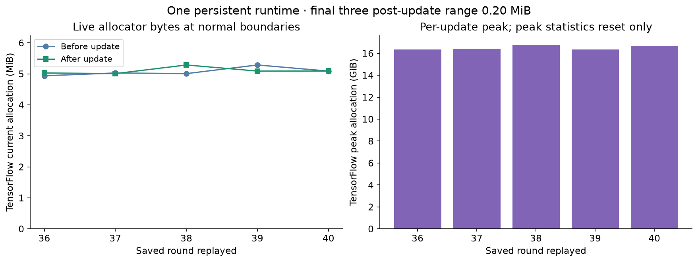
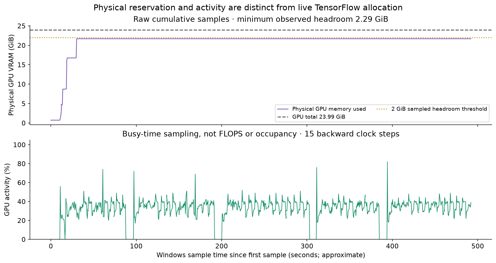

# Consecutive actor-cache updates, October 26, 2026

Five consecutive saved-round updates completed in one persistent GPU model/trainer process. Every update released its cached Tensor objects, readers, temporary mappings and PPO workers. The original model, both Adam states and PCG continued without reset; model and RL settings were unchanged.

Tracked post-update TensorFlow allocations stayed between **5.008 and 5.286 MiB**. The last three boundaries differed by **0.196 MiB**, below the preregistered 256 MiB plateau criterion. Physical GPU memory peaked at **21.69 GiB**, leaving at least **2.29 GiB** in the samples. Lifecycle gate passed; the separate 2 GiB sampled headroom gate **passed**.

Host RAM needs a separate follow-up: post-update RSS rose from **3.40 to 4.29 GiB** over the five updates, mostly anonymous/private memory. No swapping or new OOM kill was observed, but a host-RAM plateau was not established. These snapshots do not distinguish allocator retention from live internal allocations. The GPU result does not establish overall long-run memory stability.

| Saved round | Update seconds | Accepted actor steps | Rejected proposals | Live TF allocations after, MiB | TF allocation peak, GiB |
| --- | ---: | ---: | ---: | ---: | ---: |
| 36 | 91.2 | 342 | 5 | 5.029 | 16.35 |
| 37 | 107.9 | 336 | 7 | 5.008 | 16.40 |
| 38 | 114.9 | 171 | 10 | 5.286 | 16.78 |
| 39 | 85.4 | 342 | 5 | 5.090 | 16.34 |
| 40 | 110.8 | 334 | 9 | 5.092 | 16.64 |

All 1,310 arrays in five final-state archives were finite and their group hashes matched. Independent checks reconstructed each PCG order, optimizer increments, guard-pass cache reuse and exact 800-game training / 200-game held-out partitions. All 205 source checkpoint files and source/runtime pins were preserved. Linux OOM-counter delta was 0; swapout was 0 pages. The full sampled memory evidence, including RSS and pressure, is in [results.json](results.json).

TensorFlow tracked allocations and physical GPU reservation measure different things. High physical reservation can remain after cached tensors are freed; it is not by itself a leak. Logical cache caps exclude activations, allocator bookkeeping and workspaces. Samples can miss short peaks. This finite test shows no observed cache accumulation over these five updates; it does not prove universal leak freedom or capacity for larger rounds/minibatches.

This replays historical rounds 36–40 from checkpoint 35. Later saved behavior policies can differ from the evolving diagnostic policy, so there is no fresh on-policy learning or strength claim. Different guard work also prevents using these durations as a speedup comparison. No games were generated and no updated checkpoint was promoted. No resident game-generation workers were added; full production worker/Windows-host memory coexistence remains unmeasured.

Both GPU input-cache payload caps remained 8 GiB, batch size 512, with selective cuDNN and the previously verified pipeline optimizations. Diagnostic compute, contexts, locks and the temporary laptop inhibitor are gone. The separately authorized Windows day-awake guard remains active until midnight Arizona.
