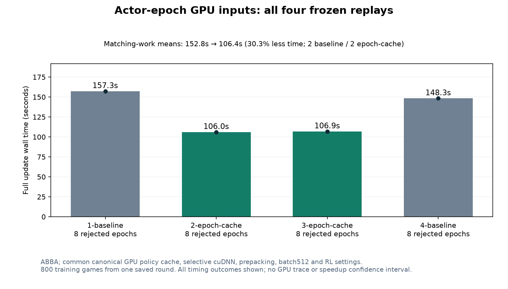

# Actor epoch input cache, October 26, 2026

The updater now offers a bounded, opt-in GPU cache for each epoch's immutable shuffled inputs. Backtracking retries reuse those inputs; policy outputs, gradients, optimizer steps and guard checks are still recomputed. The critic and canonical policy cache remain independent. The model, PPO recipe, batch size, both Adam initial states and initial PCG are unchanged.

On the frozen round 40 benchmark, matching-work means were **152.77s baseline → 106.44s with epoch caching**, **30.33% less time** (1.435x throughput). All four timings and unmatched work, if any, remain in [results.json](results.json).

The 8 GiB actor-cache limit retains 153 of 167 batches per epoch, with 14 batches using the normal CPU fallback. Both full shuffled orders were validated byte-for-byte against original collation while the canonical GPU cache was resident. All three joint backward cases passed: two admitted GPU batches and the short fallback batch. All six full-update model/both-Adam comparisons stayed within declared tolerances; final PCG and comparable-work guard decisions were exact. Nine local tests passed.

This measures one saved round without resident game-generation workers, not full training throughput or learning strength. Logical payload limits exclude allocator/workspace overhead; see [memory measurements](cache-memory.png). GPU activity is busy time, not available compute capacity. Use a fresh pinned deployment; never edit an active study.

The first exhaustive validation was killed during host memory pressure before any timed cases ran. Its reports and immutable sources remain backed up. The repaired validation removed a redundant host cache and used temporary GPU handles for exact reads, preserving all 501 input checks, both orders, three gradient cases and all caps/tolerances. The timed updater was unchanged between attempts. Validation-only memory measurements stay separate from timed updater measurements.

All diagnostic jobs and locks are cleaned up; the separately authorized Windows day-awake guard remains active until midnight Arizona.
