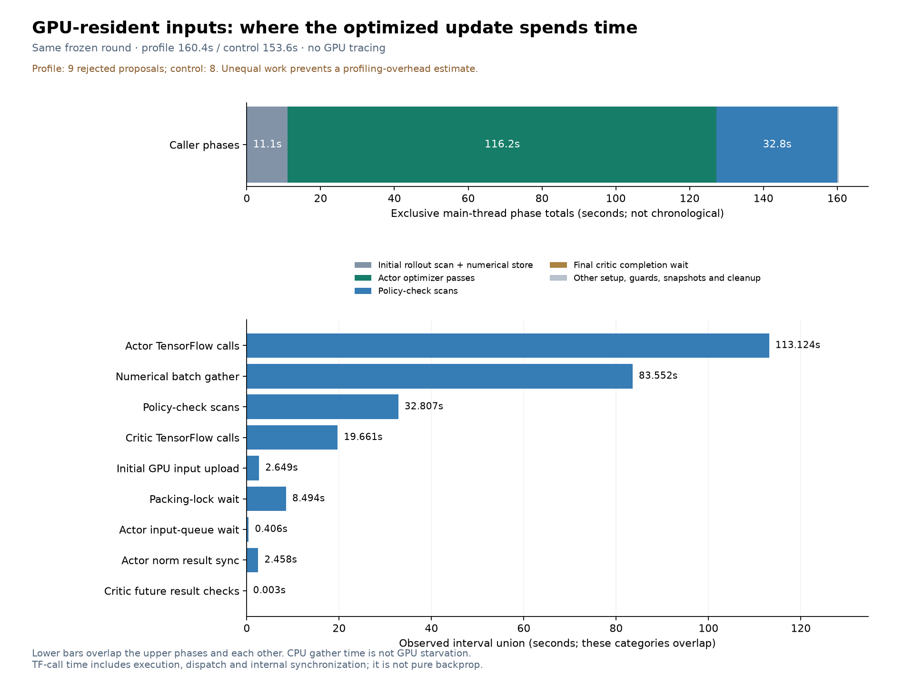

The optimized GPU-input updater was profiled on one frozen round, followed by an unchanged control. The profile took 160.41 seconds with 9 rejected proposals; the control took 153.60 seconds with 8. Their unequal work prevents estimating profiling overhead or an optimization speedup. Initial weights, both Adam states, PCG, configuration and training inputs matched. Final PCG matched exactly, and all final arrays passed the declared numerical envelopes.

The profile spent 116.19 seconds in actor optimizer passes, 32.81 seconds in policy checks and 11.10 seconds preparing the rollout. Numerical gathering took 83.55 seconds across workers, with 80.24 seconds overlapping actor passes; this is not 83.55 seconds of removable wall time. Actor input-queue wait was 0.406 seconds and explicit norm-result synchronization 2.458 seconds. TensorFlow call time includes execution, dispatch and internal synchronization. Caching the same shuffled inputs across backtracking attempts is the next controlled experiment.

The model, RL settings and original checkpoints stayed unchanged. No games or GPU kernel trace were run. Diagnostic processes and locks are clean, and the laptop inhibitor was released. The separately authorized Windows keep-awake guard remains active until midnight Arizona.

See [results and limitations](results.json), [validation](validation.json), [source review](source-review.json) and [artifact inventory](inventory.json).
