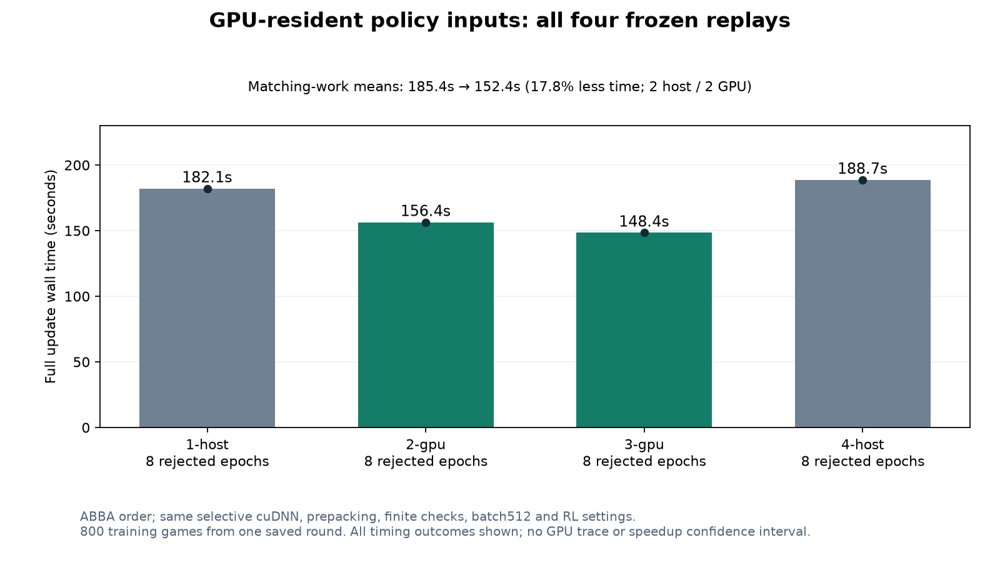

# GPU policy-input cache benchmark, October 26, 2026

Four frozen round 40 update replays used the same checkpoint 39, model, both Adam states, RNG, 85,199 training records and PPO settings. All used selective cuDNN, prepacking and consolidated finite-gradient checks. Timings include initial input storage/upload and cleanup.

CPU-cache mean: **185.41s**. GPU-cache mean: **152.42s**. Comparable-work reduction: **17.79%** (1.216x throughput). All outcomes and comparable-work groups remain in [results.json](results.json).

The GPU cache uploaded167 canonical input batches once,6,229,903,445 logical bytes (about5.80 GiB), with zero fallback. Fresh policy outputs and KL checks still run after every proposal; shuffled optimizer batches retain their original path. The 8 GiB admission cap excludes allocator overhead and activations.

Every canonical batch and six shuffled batches matched exactly. Three joint GPU forward/backward cases passed. All six final model/both Adam comparisons passed declared tolerances; final PCG and comparable-work guard decisions matched exactly. GPU arrays are not bitwise identical. Nine local focused/regression tests passed.

This is one saved round, without resident game workers. It establishes an isolated update speedup, not full training throughput or better learning. GPU activity is sampled busy time, not compute capacity. The cache remains opt-in. Reports/checkpoints stayed unchanged; all diagnostic processes/locks were cleaned up. The separately authorized Windows day-awake guard remains active until midnight Arizona.
