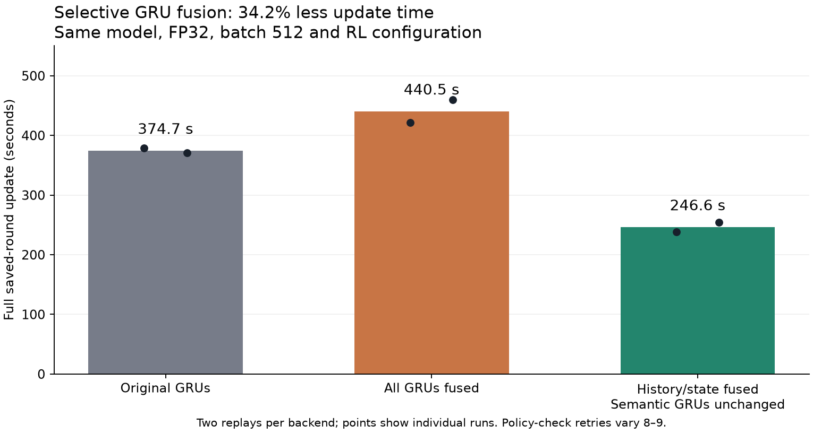
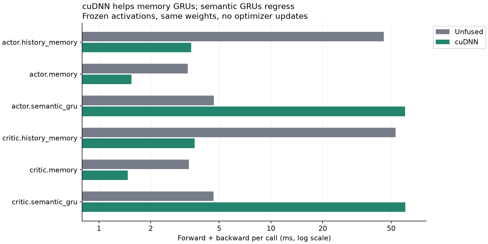

# GRU backend benchmark — October 25, 2026

Selective cuDNN fusion reduced observed full-update time by 34.2% (1.52× throughput). Fuse the four history/state-memory GRUs and retain the original two semantic GRUs. Fusing all six was 17.6% slower on average. The implementation remains opt-in; model architecture, learned weights and RL settings are unchanged.

| Backend | Mean full-update seconds | Replays |
| --- | ---: | ---: |
| Original / unfused | 374.7 | 2 |
| All six GRUs cuDNN | 440.5 | 2 |
| History/state cuDNN, semantic unfused | 246.6 | 2 |



The benchmark replays saved round 40 from checkpoint 39 in disposable models. It uses the original 800 training games (85,199 records) and excludes the 200 whole-game holdout games. Every replay restores the same starting model, both Adam optimizers and PCG state. FP32, batch 512, two PPO epochs, learning rates, policy limits, critic cap, concurrency, caches and prefetch settings remain identical. No games were generated and no diagnostic checkpoint was promoted.

All six replays accepted 334 actor steps and took 157 critic steps. Policy-guard retry counts varied with floating-point execution, so all trial counts are reported below. The selective trial with nine retries still used 32.7%; 31.3% less time than the two nine-retry original controls. These matching-work comparisons share one selective measurement; they are not independent replications.

| Trial, in execution order | Update seconds | Rejected proposals |
| --- | ---: | ---: |
| 1-unfused | 378.4 | 9 |
| 2-cudnn | 421.4 | 8 |
| 3-cudnn | 459.6 | 9 |
| 4-unfused | 370.9 | 9 |
| 1-cudnn-memory | 238.4 | 8 |
| 2-cudnn-memory | 254.7 | 9 |

The initial all-GRU study used unfused/cuDNN/cuDNN/unfused order. A read-only layer diagnostic followed; selective fusion was chosen from that diagnostic and then repeated twice. This is an exploratory performance follow-up on one saved late-training round, not a prediction of speed across every training round. Startup, checkpoint loading and graph tracing are outside the update timer. Packing, policy checks, backtracking, actor updates and concurrent critic fitting are inside it.

## Numerical checks

Both fused modes passed three 512-record batches from the training partition, plus a 512-record edge batch with empty semantics, empty histories and mixed memory advancement. Checks cover logits, action probabilities, values, actor/critic memory, losses, all trainable-weight gradients, and gradients with respect to entity/semantic/history inputs and incoming memories. Training and inference forwards are checked. Strict backend selection and successful execution verify four cuDNN forward/backward GRUs in selective mode, six in all-fused mode; fallback is disallowed.

For selective fusion the maximum probability difference was 9.54e-07; the largest component-wise gradient difference was 2.38e-07, and the worst global relative L2 gradient difference was 4.4e-06. Preregistered tolerances were output atol 2e-5/rtol 2e-4, gradient atol 2e-5/rtol 2e-3, plus gradient global relative L2 at most 1e-3. These are same-weight numerical checks; multi-step GPU Adam states need not be bitwise identical. Final PCG state and optimizer iteration counters match across all six full replays.

The first diagnostic incorrectly requested several backward traversals from one cuDNN forward using a persistent tape. A tiny reproduction isolated incorrect repeated-backward results in this installed stack. The diagnostic was repaired to request all derivatives in one backward traversal, with independent actor/critic input identities. Production PPO already uses one backward traversal. The original failed report and raw error remain preserved; no full update was admitted by that failed gate.

## Why selective fusion helps

The captured semantic GRUs process shape [16384, 1, 64], including 6,427 empty rows. The history GRUs process [512, 17, 32] for the actor and [512, 17, 64] for the critic. State-memory updates have one timestep and batch 512. cuDNN helps the latter memory workloads but regresses substantially for the very large batch of one-timestep semantic sequences.

These isolated timings use the same frozen activations and weights, five warmups, three repeats of 20 calls, and unfused/cuDNN/cuDNN/unfused order. Each backward call requests all derivatives once. No optimizer updates occur. They explain the candidate selection but do not sum directly to full-update wall time.

| GRU | Original forward + backward, ms | cuDNN, ms | Original / cuDNN |
| --- | ---: | ---: | ---: |
| actor.history_memory | 45.26 | 3.44 | 13.17× |
| actor.memory | 3.28 | 1.55 | 2.12× |
| actor.semantic_gru | 4.66 | 60.25 | 0.08× |
| critic.history_memory | 53.00 | 3.60 | 14.72× |
| critic.memory | 3.33 | 1.47 | 2.27× |
| critic.semantic_gru | 4.63 | 60.34 | 0.08× |



## Implementation and reproduction

`src/patchwork_automaton/neural/recurrent.py` provides `configure_gru_backend(model, 'cudnn-memory')`, called before tracing the learner. Existing model/checkpoint constructors continue to default to the original backend. A masked-row adapter gives empty sequences a disposable first timestep, then restores exact zero outputs and zero derivative contribution; existing history logic preserves incoming memory. Other masks remain unchanged and cuDNN rejects unsupported padding.

On Raytracer's recorded GPU environment, with this checkout on PYTHONPATH, run the equivalence gate before each isolated replay:

```bash
PYTHONPATH=src:. python -m examples.benchmark_fused_gru --source /path/to/frozen-study --output /path/to/new-parity --gru-backend cudnn-memory
PYTHONPATH=src:. python -m examples.benchmark_fused_gru_update --source /path/to/frozen-study --output /path/to/new-replay --round 40 --device gpu --gru-backend cudnn-memory
```

Use unique output directories, the recorded CUDA environment and the shared training lock. The archived coordinators/manifests document the actual finite launch sequence. Twenty-four focused CPU tests passed, covering masking/gradients, checkpoint round-trip, neural behavior, update pipeline and prompt-memory semantics; both GPU parity gates passed all four cases. Sources also passed compilation and diff checks.

All 205 original checkpoint files and the original frozen runtime remain unchanged. The final archive contains all six disposable model/optimizer results; gzip and ZIP CRCs and finite arrays were verified. Remote owned processes and GPU contexts are gone, the shared lock is free, and temporary Windows/laptop awake guards were released. No SSH, services, decks, permanent power settings or RL hyperparameters changed.
