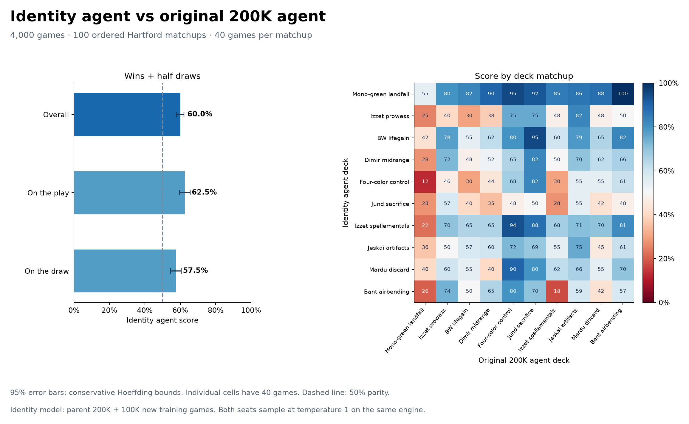
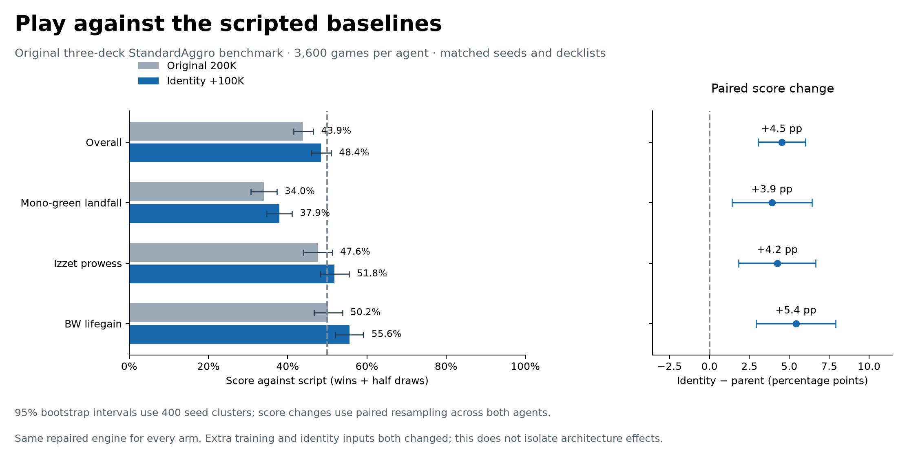

# Identity agent: completed comparisons

All 11,200 separately recorded evaluation games completed and passed the full audit. Both completed training experiments, all 302 checkpoints and all frozen source/model/engine artifacts remain unchanged. The evaluation guard exited normally; minimum available physical RAM was 4.52 GiB.

| Opponent | Games | Identity score | Parent score | Change |
|---|---:|---:|---:|---:|
| Original 200K agent | 4,000 | 60.01% | — | — |
| Scripted overall | 3,600 per agent | 48.44% | 43.92% | +4.53 pp |
| Scripted mono-green landfall | 1,200 per agent | 37.92% | 34.00% | +3.92 pp |
| Scripted Izzet prowess | 1,200 per agent | 51.83% | 47.58% | +4.25 pp |
| Scripted BW lifegain | 1,200 per agent | 55.58% | 50.17% | +5.42 pp |

Score means wins plus half draws. The head-to-head recorded 2,343 identity wins, 1,542 losses and 115 draws; its conservative 95% score interval is 57.87–62.16%. Against the scripts, the identity agent won 1,744/3,600 games and the parent won 1,581/3,600, with no draws. The paired overall gain is 4.53 percentage points (95% clustered bootstrap interval +3.06 to +6.03).

The neural duel covers 100 ordered Hartford matchups, 40 games each, with balanced learner seats and starting players. The historical baseline panel uses the original mono-green landfall, Izzet prowess and BW lifegain decklists with StandardAggro: nine ordered cells, 400 games per cell. Both model arms share the same 400 seed offsets repeated across cells, allowing paired clustered resampling. Both neural seats sample at temperature 1. All panels use frozen project-trigger-v2 and engine 4f64940. The neural duel retains the 20-second production deadline; both baseline arms reproduce the original 60-second benchmark deadline. All panels retain 50 turns and 6,000 decisions.

The new identity model is local checkpoint 100 after 100K additional collection games, initialized from the original 200K policy. Thus it has 300K total game exposure. Extra training and identity inputs both changed; these results do not isolate the architecture contribution. It improves on the parent in this panel, but scripted mono-green remains a clear weakness (37.9%).

The audit recomputed summaries and checked every scheduled identity, seed, deck/seat/start assignment, policy/source/engine hash and all original training checkpoints, with zero failed games and no training trajectories. The 115 neural-duel draws comprise 0 natural draws and 115 adjudications; diagnostics are preserved on Raytracer.

Evidence: [audit.json](audit.json), [result.json](result.json), [paired_baseline_differences.json](paired_baseline_differences.json), [games.json.gz](games.json.gz), [manifests.json](manifests.json), [launch.json](launch.json). Standalone SVG versions accompany both PNG figures.
