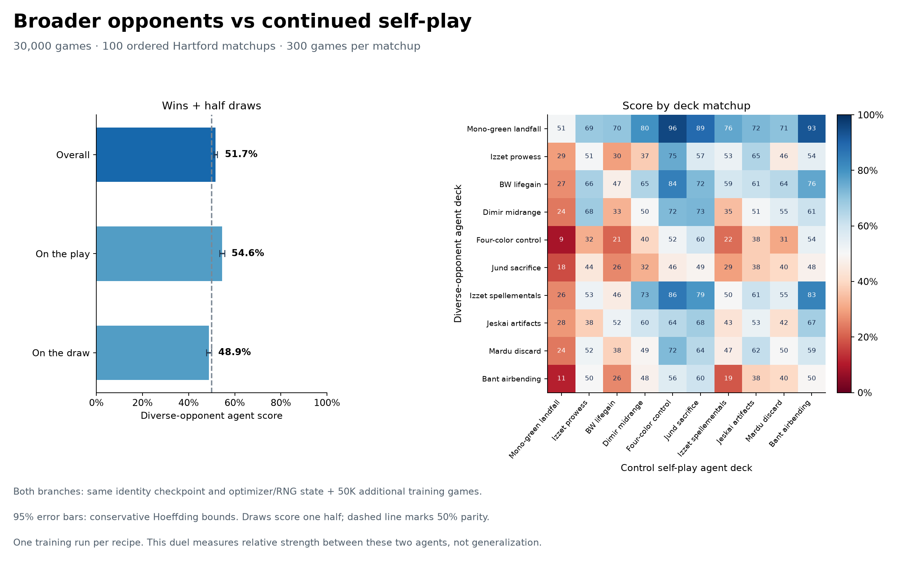

# Extended Hartford head-to-head

The diverse-opponent agent scored **51.73%** over 30,000 games.
The nominal conservative 95% interval is 50.94%–52.51%.
It recorded 15,080 wins, 14,045 losses and 875 draws.
Score gives draws half a win.

The original 10,000 outcomes and 20,000 fresh outcomes passed complete audits.
Both batches use the same final models, frozen gameplay source, engine, 48 workers,
temperature 1 and 20-second, 50-turn and 6,000-decision limits. Each of 100 ordered
matchups has 300 games, split evenly into its four seat/start combinations.
All original outcomes and adjudication diagnostics retain their pinned hashes.

The additional sample size was fixed after viewing the first 10K result.
Intervals are nominal fixed-sample Hoeffding bounds. One training run per recipe
contributes to this comparison.

Evidence accompanies this graph in audit.json, result.json, manifests.json and games.json.gz.

Eight original timeout draws were recovered from their saved adjudication files after
a post-game inference reset error blocked collector publication. The failed attempt
and original guard logs remain preserved. The publication repair passed its fresh
guard and complete audit with zero games replayed. Seven of these eight records
had zero decisions when their original hard deadlines expired.
