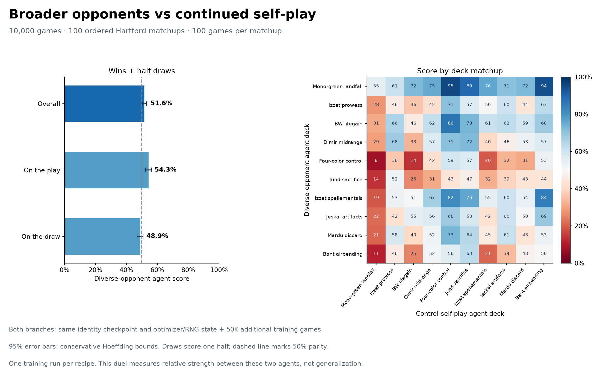

# Identity opponent-diversity endpoint comparison

The completed 10,000-game head-to-head passed its complete schedule, outcome,
model/source/parent integrity and resource-guard audit. Both training arms
completed 50,000 additional games from the same identity checkpoint with the
same initial actor/critic optimizer and trainer RNG state.

The diverse-opponent agent scored **51.61%** against the control
self-play agent (95% conservative interval 50.25%–52.96%):
5,019 wins, 4,698 losses and 283 draws.
Score counts draws as half a win; raw win rate was 50.19%.

The panel contains 100 games in each of 100 ordered Hartford deck matchups,
with 25 games for each learner-seat/starting-player combination. Both seats
sample at temperature 1, with a 20-second per-game deadline, 50-turn limit and
6,000-decision limit. Timeout/turn-limit draws retain their diagnostics.
The audit reports 0 natural draws and
283 adjudications. No baseline panel was run.

This is one training run per recipe and one relative-strength comparison.
The interval measures evaluation-game uncertainty, not variation across
independent training runs or performance against unseen opponents.

Evidence: [audit](audit.json), [result](result.json), [manifest](manifest.json),
[all 10,000 outcomes](games.json.gz), [SVG figure](head-to-head.svg).
