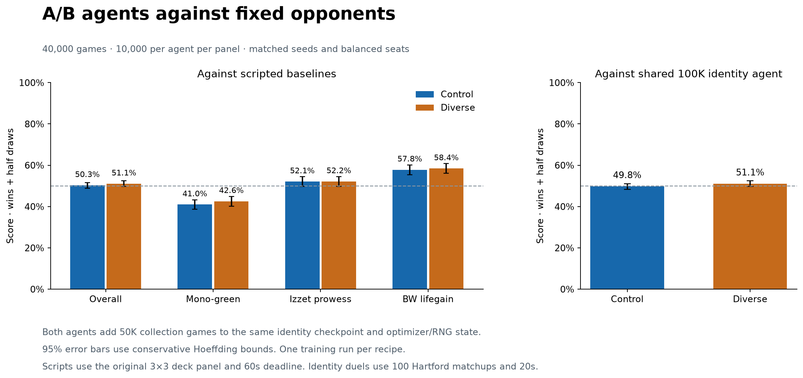

# Fixed-opponent comparison results

| Agent | Opponent | Games | Score | 95% interval | Wins / losses / draws |
| --- | --- | ---: | ---: | --- | --- |
| control | Scripted baselines | 10,000 | 50.30% | 48.94%–51.66% | 5030 / 4970 / 0 |
| diverse | Scripted baselines | 10,000 | 51.06% | 49.70%–52.42% | 5106 / 4894 / 0 |
| control | Shared identity checkpoint 100 | 10,000 | 49.76% | 48.40%–51.12% | 4842 / 4890 / 268 |
| diverse | Shared identity checkpoint 100 | 10,000 | 51.07% | 49.71%–52.42% | 4941 / 4728 / 331 |

Score counts draws as half a win. Each agent used matching fresh seeds and seat/start assignments.
The scripted panel uses the original three decklists. The shared reference is the identity checkpoint
that started both arms, with 100K identity training games and 300K total inherited exposure.
Both current agents have 350K total exposure. One trained agent represents each recipe.

The audit recovered 0 completed handoffs after transport cleanup errors.
Original handoffs, adjudication diagnostics and any transport-error resolutions remain preserved.
