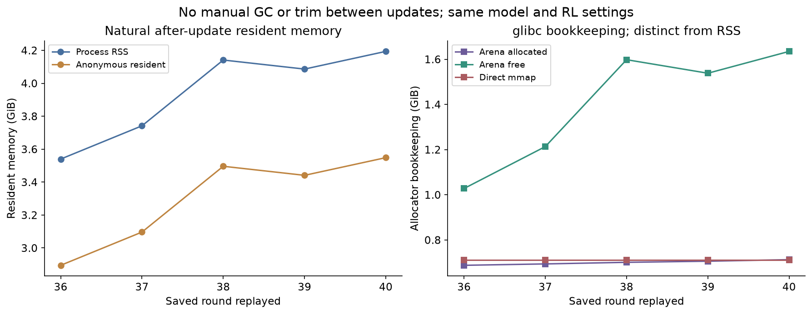
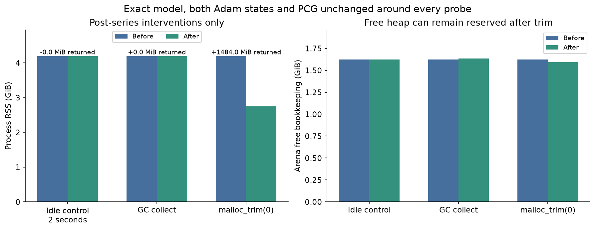

# Host RAM attribution, October 26, 2026

The evidence points primarily to native allocator retention as the explanation for the observed RSS growth. In this repeat, post-update RSS grew **669.6 MiB** across five saved updates. glibc's free-arena bookkeeping grew **621.7 MiB**, while allocated-arena bookkeeping grew **25.6 MiB**; direct mmap bookkeeping stayed unchanged. Arena count stayed at 49 after the first update. Bookkeeping is not an exact resident-memory breakdown.

After all five normal updates, a two-second idle control changed RSS by only 16 KiB. Python GC collected 68 objects and created about 12.12 MiB of additional free allocator space, with no RSS drop. A subsequent [malloc_trim(0)](https://man7.org/linux/man-pages/man3/malloc_trim.3.html) request returned **1.449 GiB** of process-resident memory: **4.194 → 2.745 GiB**. Allocated bookkeeping changed by only 5488 bytes during trim. Exact model, both Adam states and PCG hashes stayed unchanged around every probe.

| Saved round | RSS after update, GiB | Allocated arena bookkeeping, MiB | Free arena bookkeeping, MiB |
| --- | ---: | ---: | ---: |
| 0036 | 3.540 | 704.2 | 1052.4 |
| 0037 | 3.742 | 710.5 | 1242.4 |
| 0038 | 4.141 | 717.7 | 1636.4 |
| 0039 | 4.086 | 722.8 | 1575.0 |
| 0040 | 4.194 | 729.8 | 1674.1 |

These observations demonstrate substantial reclaimable glibc-managed resident pages. They support retention as the main explanation and do not exactly apportion all historical growth or rule out every leak. GC preceded trim; its roughly 12 MiB allocator change was far smaller than the later 1.45 GiB RSS return. Virtual arena reservation fell only about 29 MiB during trim, illustrating that resident pages and reserved address space differ. See the [malloc_info documentation](https://man7.org/linux/man-pages/man3/malloc_info.3.html) and [glibc statistics](https://sourceware.org/glibc/manual/latest/html_node/Statistics-of-Malloc.html) for the measurements' scope.

The unchanged original sampler and lifetime observer were retained. Their named-container size estimates grew about 18 MiB, much smaller than the 670 MiB RSS increase, though observation, JSON serialization and state hashing can perturb allocation patterns. No tracemalloc or manual GC/trim ran between updates. No cached tensor objects, readers or PPO workers survived normal update boundaries; graph traces remained stable. The same model/trainer carried weights, both optimizers and PCG through five updates. All five 262-array state archives and all 205 original checkpoint files verified.

No production allocator policy is enabled. The trim call itself took 14.7 ms here; per-update trimming would also change later page faults/allocation costs and needs its own benchmark. Full-run host memory stability, larger shapes and concurrent game-worker memory remain unmeasured. Saved historical behavior policies can differ from the diagnostic model; this is runtime evidence, not new learning or speedup evidence.

All diagnostic processes, GPU contexts, locks and the temporary laptop inhibitor are cleaned up. The separate Windows day-awake guard remains active until midnight Arizona. No source checkpoint or learning setting changed.
