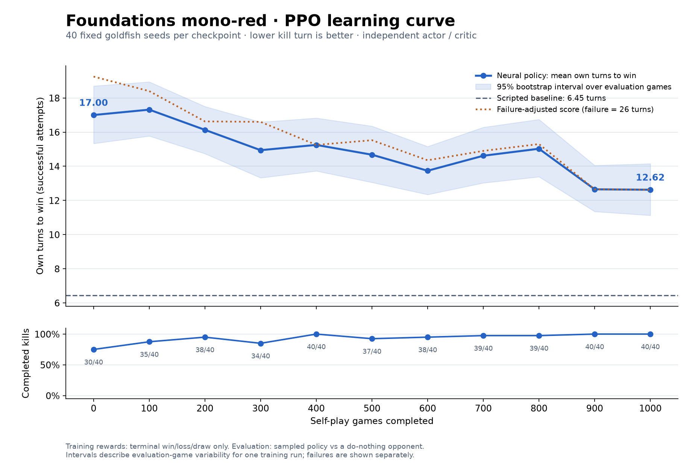
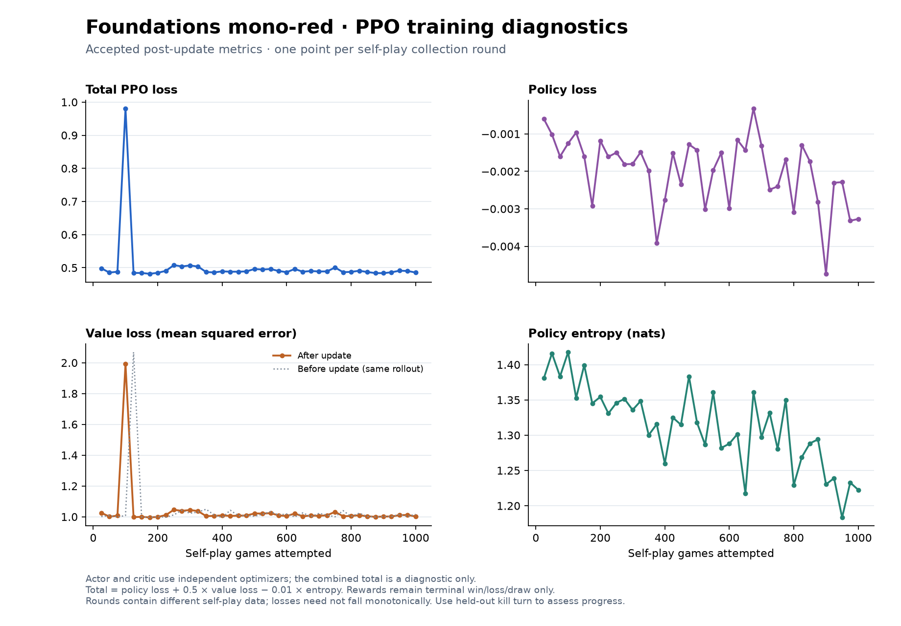
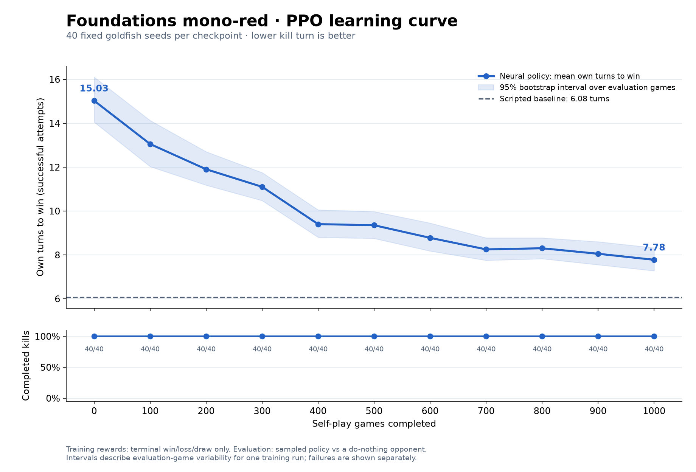
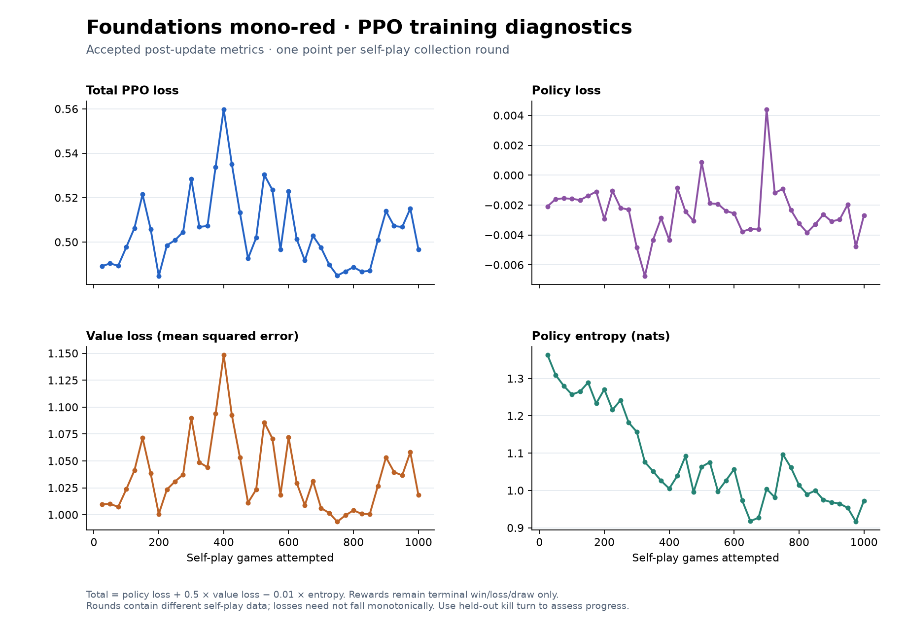
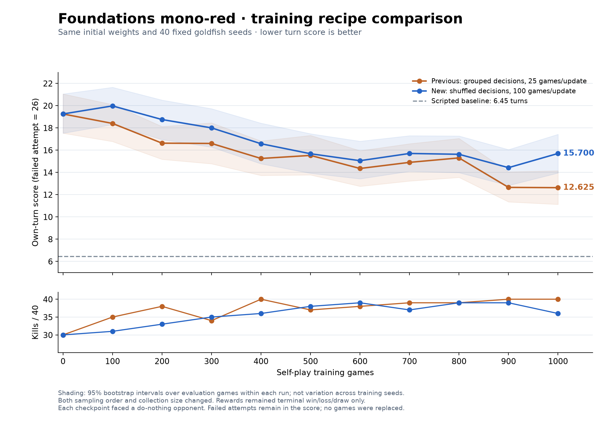
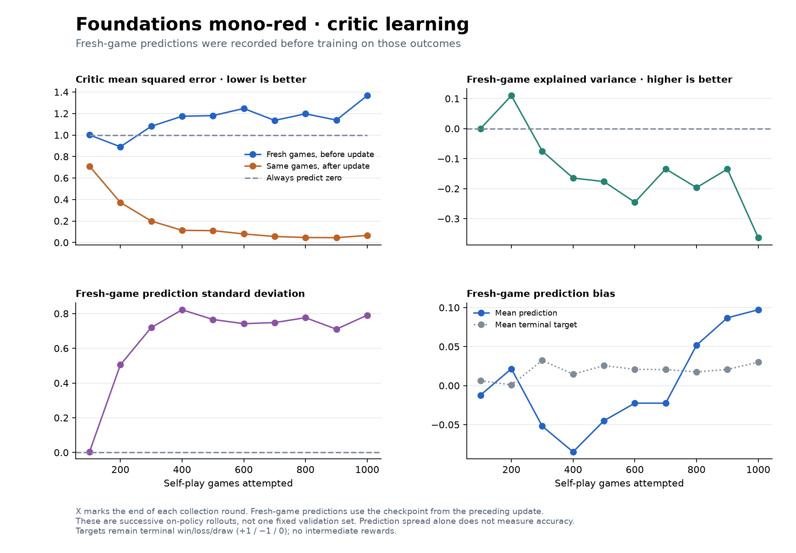
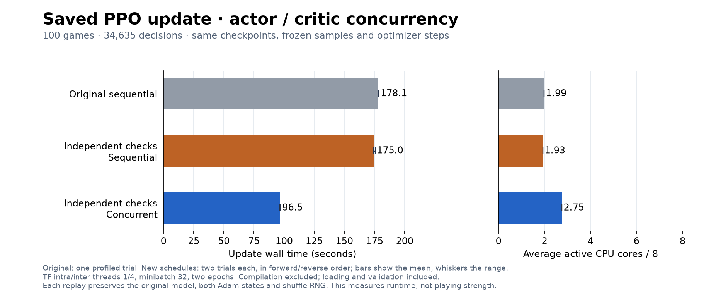
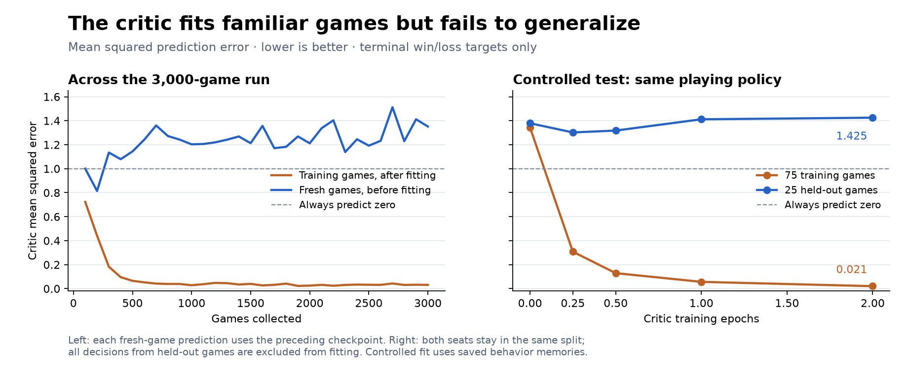
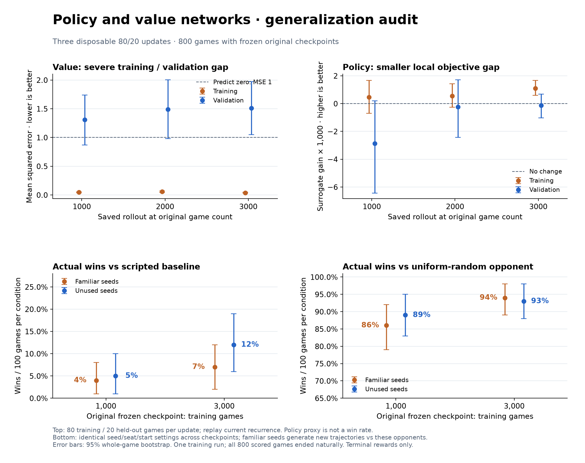

# Foundations mono-red CPU PPO

This experiment uses the 60-card **Foundations Red Aggro** list: **22 lands,
19 creatures and 19 instants**. It contains 22 Mountains; four each of Fanatical
Firebrand, Ghitu Lavarunner, Firebrand Archer and Viashino Pyromancer plus three
Firespitter Whelps; and four each of Burst Lightning, Kindled Fury, Sure Strike
and Scorching Dragonfire plus three Fiery Annihilations. Training games are mono-red mirrors under normal
RustMage rules. Both seats use the same frozen behavior checkpoint within a
collection round and sample their own actions independently.

The original shared-encoder experiments below used the previous **24-land,
32-creature, 4-instant** list. Their graphs and checkpoints remain historical
results for that deck. The independent actor/critic experiment uses the current
22/19/19 list. The new card vocabulary and semantic schema change the checkpoint
fingerprint: start a fresh run in a new output directory. Existing checkpoints
are rejected rather than interpreting their card IDs as the new cards. To
reproduce the old reports, use their recorded source revision and deck manifest.

There is **no imitation warm-up and no intermediate reward**. A verified natural
win gives +1, a loss −1, and a draw 0. Every recorded decision in a seat's game
receives that terminal return, undiscounted. Turns, life totals, damage, lands,
and spell casts are observation features, never reward bonuses. Errors and
compute-limit cutoffs are excluded from PPO and reported explicitly. They are
not converted to losses, draws, concessions, or successful replacement games.

New runs default to an **80% training / 20% validation split within each
self-play collection round**. All decisions from both seats of one game stay
together. Splitting is deterministic by experiment seed and round, independent
of worker completion order, and happens before filtering errors or cutoffs.
Only training games enter either optimizer or advantage normalization. Held-out
games are used for read-only diagnostics after the update, then remain held out;
subsequent rounds collect new seeds. This is a rolling on-policy validation set,
separate from the fixed goldfish evaluations.

With 100 games per round, 80 train the networks and 20 validate them. A
1,000-game collection therefore gives 800 training games and 200 validation
games, before exclusions for failed attempts. Non-multiples of five round the
validation count up: the 32-game recipe below gives 25 training / 7 validation
games per round. Reports distinguish collected, optimized, and held-out counts.
Historical `training_games` fields retain their original collected-attempt
meaning for compatibility. `--validation-fraction` is saved and checked on
resume; **resuming older runs requires explicit `--validation-fraction 0`**.
Historical experiments below predate this split unless stated otherwise.

## Run and resume

Install the neural dependencies and build the pinned RustMage backend as
described in [the backend setup](rustmage.md):

```sh
uv sync --python 3.12 --extra neural
uv run --no-sync python scripts/rustmage-local.py
uv run --no-sync python -m examples.train_rustmage \
  --output .local/red-ppo --rounds 32 --games-per-round 32 \
  --eval-games 40 --eval-horizon 25
```

That collects 1,024 self-play games, with 32 games per update round, using 24
independent native match processes and two frozen TensorFlow inference processes,
with 12 game engines assigned to each. The engine count is 24 total, not per
inference process. Updates occur only after all workers finish their collection round.
CPU execution is the default; one TensorFlow intra-operation thread and four
inter-operation threads are used unless explicitly configured in the environment.
`--inference-processes N` selects the replica count. New process-collector runs
default to two (one if there is only one engine); the thread collector uses one.
Each replica has its own queue, batching thread and TensorFlow runtime. Game
engines send observations directly to their assigned replica through local
pipes, bypassing the learner. Replicas persist across rounds and receive identical
weights after each update, before evaluation or new collection. All must acknowledge
the expected weight hash and policy version before collection can proceed.
The count is checkpointed. A resume without an explicit override uses the saved
count; checkpoints predating replicas retain one. A different count is rejected
by the normal configuration check. `--inference-processes 1` remains available
for new comparison runs.
`--rounds` is the total target round number, including previously completed rounds.
For a separate actor/critic, `--concurrent-updates` overlaps their independent
optimizer work. It is opt-in and recorded in the experiment configuration;
resuming requires the original setting. Older checkpoints default to sequential
updates. The shared architecture cannot enable this option.
`--prefetch-batches N` prepares up to N queued minibatches per optimizer stream;
the default 0 prepares them synchronously. `--measurement-workers N` runs loss
and KL batches concurrently while the measured weights are frozen; its default
is 1. These pipeline options are also recorded and checked on resume. Retained
cache data still has its byte budget; queued batches and active graph workspaces
are additional bounded-by-count transient allocations.

For an exact 1,000-game run with a held-out evaluation every 100 games and a
learning-curve graph, use 10 update rounds of 100 games. This uses the corrected
cross-game shuffle and increases the number of independent outcomes per update:

```sh
uv sync --extra neural --extra plots
TF_NUM_INTRAOP_THREADS=1 TF_NUM_INTEROP_THREADS=4 \
uv run --no-sync python -m examples.train_rustmage \
  --output .local/red-curve --rounds 10 --games-per-round 100 \
  --eval-every-games 100 --eval-games 40 --eval-horizon 25 --workers 24 \
  --architecture separate --collector processes --inference-processes 2 --inference-wait-ms 0 --plot
```

These CPU concurrency settings were measured on the eight-core development
laptop; see [the parallelism experiment](#cpu-parallelism-experiment-october-18-2026).
The defaults retain 24 game processes, TF intra/inter limits of 1/4 and zero
batching delay. The later replicated-inference change uses two inference
processes sharing those 24 engines. Counts
and environment variables remain overridable for other machines. Zero delay
serves all currently queued requests immediately, still up to the worker count
per batch. Each invocation records its TensorFlow thread environment.

For older runs, pass the original worker/collector settings and
`--inference-wait-ms 2` when resuming. A checkpoint that predates the batching
option is interpreted as having the original 2 ms delay; configuration checks
reject a different value. Set `TF_NUM_INTRAOP_THREADS=2` and
`TF_NUM_INTEROP_THREADS=1` to reproduce the earlier runtime settings as well.

This starts from fresh random weights and evaluates at 0, 100, ..., 1,000
self-play games. Every point uses the same held-out seeds, seats, starting
players and action-sampling seeds. Evaluation data never enters PPO. Each
100-game update is checkpointed; the reports associate each evaluation with its
checkpoint hash. `learning-curve.png`, `.svg` and `.csv` show wins-only mean kill
turn, bootstrap intervals over evaluation games, and completion counts. A
failure-adjusted score appears when any attempts fail. These intervals describe
one training run's evaluation sample, not variability across training runs.

`learning-curve-losses.png` and `.svg` contain total PPO loss, policy loss,
value loss and policy entropy after each accepted update. The accompanying
`.csv` also records KL divergence, gradient norms and rejected epochs. These
losses are measured on each round's own frozen self-play data, so they need not
decrease monotonically as the policy and its opponents change. Use the held-out
kill-turn curve to judge improvement at this metric.

`learning-curve-validation.png`, `.svg` and `.csv` compare the newly updated
policy and value networks on their training and held-out games. Value error is
MSE against terminal returns, with an always-zero reference. Policy validation
measures change in the clipped PPO surrogate relative to the behavior policy,
using frozen behavior probabilities/values and training-only normalization.
It is a local, noisy outcome-based proxy, not action accuracy or a win rate.
Both partitions regenerate recurrent state from zero using current weights on
the recorded observations/actions. Confidence intervals resample whole games,
keeping both seats and all decisions together. These diagnostics currently
monitor training; they do not select checkpoints, alter rewards, or stop an
optimizer early. Validation time is recorded separately, including a throughput
metric that includes collection, updates and validation.

For runs that record `behavior_critic`, `learning-curve-critic.png`, `.svg` and
`.csv` additionally show prediction error before and after fitting each rollout,
fresh-game explained variance, prediction spread and prediction bias. These
fresh-game predictions come from the preceding checkpoint, before training on
those outcomes. A collection of 100 games gives one point at its ending game
count, not an extra fixed validation set for the newly updated checkpoint.

Use the same command with `--resume` after interruption. A missing evaluation at
the latest checkpoint boundary is completed before collecting more training
games. An update saved just before report publication is recovered from its
checkpoint metadata. The evaluation interval must be a multiple of the number
of games per update. Omitting the interval preserves endpoint-only evaluation.
Plots can also be regenerated from the saved report without running games:

```sh
uv run --no-sync python -m examples.plot_rustmage_training .local/red-curve/report.json
```

```sh
uv run --no-sync python -m examples.train_rustmage \
  --output .local/red-ppo --rounds 64 --games-per-round 32 \
  --eval-games 40 --eval-horizon 25 --resume
```

Resume preserves both networks' weights, Adam states, optimizer iteration counts and the PPO
shuffle generator. Game and action-sampling seeds derive from the round and game
index. The remaining experiment configuration must match. Checkpoints are
written atomically at round boundaries; the incomplete current round is rerun
after interruption. Parallel TensorFlow floating-point results are not promised
to be bitwise identical across machines or different batching schedules.

`report.json` retains every evaluation attempt, every training game, per-seat
returns, action counts, update diagnostics, source hashes, the library hash and
inference batch statistics. Trusted local rollout files live in `rollouts/`;
they use Python pickle and must not be loaded from untrusted sources. Model and
optimizer checkpoints live in `checkpoints/round-NNNN/`.

## Numerical model and action space

The default `--architecture separate` uses two independent Keras 3 networks.
The actor retains width 32, memory 32, one attention block and legal-action
scoring. The critic has its own card embeddings, semantic encoder, one attention
block at width 64, memory 64 and a 64/64/1 nonlinear value head with a linear
output. It receives both pooled entity features (mean and scaled sum) and direct
player/context facts. No learned weights or recurrent memory are shared. The
96-element stored memory concatenates actor and critic state solely for batching
and serialization; each network reads only its own slice.

The critic learns mean squared error against terminal returns with its own Adam
optimizer, learning rate and gradient clipping. It takes the configured number
of PPO epochs on each rollout, independently of actor KL acceptance. Actor
backtracking restores only actor weights and optimizer state. Behavior values,
probabilities and advantages remain frozen throughout the update. The reported
combined loss retains the old weighted formula for plotting; the two optimizers
minimize their own objectives. Checkpoints include both optimizer states.

`--architecture shared` retains the earlier detached linear critic for controlled
comparisons on the current deck. The exact parameter counts are in each report
(125,026 for the old deck and original architecture). These are numerical models;
freeform prompts, card rules text and display labels never enter their tensors.

`--collector processes` runs persistent spawned game workers. By default their
private numerical arrays travel over dedicated pipes directly to two inference
processes, each with its own batching queue and frozen copy of the policy.
The learner owns the trainable model and synchronizes replicas at round
boundaries. Game workers do not execute neural models. The same game/action
seeds and trajectory format are used with
`--collector threads`. Checkpoint updates occur only after all jobs finish, and
inference rejects stale model versions. Spawn avoids forking TensorFlow's live
runtime. The historical single-service collector comparison below remains
available with:

```sh
uv run --no-sync python -m examples.benchmark_rustmage_collectors \
  --output .local/collector-benchmark --games 16
```

The [matched collection benchmark](benchmarks/foundations-red-separate-collectors-2026-10-18.json)
used the new deck and frozen independent networks (125,729 actor parameters and
241,985 critic parameters). Eight warm-up games preceded each 16-game trial;
startup/warm-up are excluded and trajectory writing is included.

| Collector | Completed games/minute | Mean CPU cores used | Mean inference batch |
| --- | ---: | ---: | ---: |
| 4 threads | 23.21 | 1.17 | 1.75 |
| 4 processes | 36.87 | 1.72 | 1.92 |
| 8 processes | 48.01 | 2.13 | 2.93 |

Eight processes delivered **2.07×** the four-thread collection throughput in
this short, fixed-order trial. All 48 games ended naturally, with matching
outcomes, decisions, action counts, turn counts and final life for all 16 paired
seeds; model weights did not change. This is game-summary equivalence, not a
claim of bitwise tensor equivalence. CPU utilization remains below eight full
cores because workers still wait on central inference. These rates exclude PPO
updates and do not establish the full-training speedup.

The new RustMage feature schema includes:

- Seat-private visible objects with exact card IDs, zone, relative controller,
  current power/toughness, damage, tap/summoning state, type/color/keyword bits,
  counters and mana value; player life, counts and mana pools.
- Reviewed partial semantic labels for these eleven cards, including red mana,
  damage, tap/sacrifice costs, cast/entry triggers, graveyard conditions,
  temporary power/first-strike buffs, damage target types, exile replacements
  and kicker. Damage and power-bonus amounts are numeric features. Effective
  keywords come from the rules engine.
- Turn, phase, active player, typed pending decision, announcing spell identity,
  pending payment, hand/land counts and actor-private numerical observation
  history. The policy observes its own view after each engine action, including
  opponent actions and forced choices.
- Typed legal actions with separately ordered source, target and secondary
  reference features, plus ability index, payments, amounts and booleans.
  Thus casting Firebrand, activating Firebrand, targeting yourself and targeting
  the opponent have distinct representations. Live object/stack IDs bind
  references but are never learned numeric identities.

The engine supplies legality. The model samples every non-forced choice; forced
single-option prompts bypass inference while their state changes accumulate in
history. There is no scripted gameplay fallback. **Voluntary Concede is excluded
explicitly in both training and evaluation.** Self-inflicted natural losses still
count. This avoids spending the first experiment learning to avoid immediate
resignation; it does not enforce playing lands, attacking, saving mana or
choosing good targets.

The adapter retains general RustMage numeric domains. This scoped neural encoder
exactly enumerates the small domains needed by the mono-red deck, deduplicates
native representative actions and raises an explicit unsupported-interaction
error if enumeration would exceed 4,096 combinations. It does not truncate menus
or claim support for arbitrary X spells or the entire catalogue. Unknown cards,
decisions and action fields fail visibly. Mono-white neural training is outside
this experiment. Burn/XMage checkpoints cannot be loaded as RustMage policies.

The training coordinator borrows each worker-owned private native view through
shallow internal records, avoiding recursive immutable copies on every action.
The public adapter retains its immutable snapshot contract. Integration tests compare every
model tensor, decision and private-history delta with the full adapter through a
complete game. The repeat detector still hashes the full private native state,
and every selected action still passes RustMage's actor/revision/legality checks.

PPO uses frozen full behavior distributions, clipped policy ratios, a value
baseline, entropy regularization, gradient clipping, and KL-guarded epoch
backtracking. Recurrent states are detached rollout states during optimization:
this is not sequence backpropagation through whole games. The critic receives
the same terminal outcome target; no intermediate value labels are supplied.

## Evaluation: turns to lethal

Before and after training, the frozen sampled policy plays the same held-out
shuffle seeds, seats and starting-player assignments against **60 Mountains and
a completely passive opponent**. The opponent keeps, passes, and answers forced
cleanup choices; it never plays lands, casts, activates, attacks, blocks or
concedes. Evaluation data never enters PPO. Policy temperature is 1 for both
checkpoints, so a greedy trained policy is not compared against a sampled random
one.

The primary figures are successful kills / all attempts and the mean number of
the agent's **own turns** in successful games. This is not the engine's global
turn counter, which also counts opponent turns. The report includes median,
90th percentile, kill-turn histogram and fraction of all attempts won by turns
4, 5, 6 and 10. Losses, draws, action-limit cutoffs, turn-limit cutoffs, repeated
visible-state cutoffs and errors remain visible.

To compare two policies without hiding failed attempts, the report also gives
an evaluation-only capped score: a win on turn T scores T; a failure by horizon
H scores H+1. Lower is better. The paired comparison reports the mean reduction
and a bootstrap interval over matched evaluation seeds. This score is **never
an RL reward**, and its arbitrary failure value should always be read alongside
the actual win and failure counts. A positive point estimate whose interval
crosses zero is not convincing evidence of improvement.

Evaluate a checkpoint independently, or omit `--checkpoint` for the scripted
Foundations baseline:

```sh
uv run --no-sync python -m examples.evaluate_rustmage \
  --checkpoint .local/red-ppo/checkpoints --games 100 --horizon 25 \
  --output .local/red-goldfish.json
uv run --no-sync python -m examples.evaluate_rustmage \
  --games 100 --horizon 25 --output .local/red-baseline-goldfish.json
```

`--greedy` is available for a separately labeled evaluation. Checkpoint hashes
are verified unchanged by the standalone evaluator. The goldfish metric measures
basic execution; it does not establish competence at blocking, interaction or
competitive play. A win-only training objective also does not directly prefer
fast kills once a policy reliably wins.

The earlier roughly 20× RustMage/XMage result measured scripted-policy games.
Neural training also pays for observation encoding, batched network inference,
trajectory storage and gradient updates. Its throughput must be measured
separately; multiplying the old neural games/minute by 20 is not justified.

## CPU parallelism experiment: October 18, 2026

The [complete parallelism report](benchmarks/foundations-red-cpu-parallelism-2026-10-18.json)
records 27 timed trials on the eight-core Intel Core Ultra 5 335, with TensorFlow
2.21 CPU execution and oneDNN disabled, as in the training run. Trials ran
sequentially. The model, deck, terminal rewards, training batch size, optimizer
settings and evaluation rules were unchanged. Collection used the frozen final
checkpoint; updates replayed round 40's 8,993 decisions from the saved round-39
model, both Adam states and shuffle RNG. Benchmark updates changed weights only
in memory and in separate diagnostic output files.

The initial sweep used 48 fixed self-play seeds per collection trial. Final
confirmation used the actual **25-game collection-round size**, with two trials
per configuration, in forward and reverse order. Every worker completed warm-up
before confirmation timing began. Startup and warm-up are excluded; collection
includes trajectory writing, and update timings include rollout reads, packing,
loss/KL scans and optimizer work.

| Phase / configuration | Mean wall time | Observed range | Mean active CPU cores |
| --- | ---: | ---: | ---: |
| 25 games: 8 workers, TF intra 2 / inter 1, 2 ms wait | 16.89 s | 16.65–17.13 s | 2.20 / 8 |
| 25 games: 24 workers, TF intra 1 / inter 4, 2 ms wait | 9.61 s | 9.57–9.65 s | 3.52 / 8 |
| 25 games: 24 workers, TF intra 1 / inter 4, zero wait | **8.28 s** | 8.09–8.47 s | **4.21 / 8** |
| Same PPO update: TF intra 2 / inter 1 | 55.44 s | 54.06–56.82 s | 1.46 / 8 |
| Same PPO update: TF intra 1 / inter 4 | **31.49 s** | 31.48–31.51 s | **2.12 / 8** |

This is **2.04× collection throughput** (88.81 → 181.15 games/minute) and
**1.76× update throughput**, measured separately. Their combined timings suggest
about 1.8× throughput for comparable collection/update workloads, excluding
evaluation and startup. This is an estimate from separate phase benchmarks, not
a newly measured 1,000-game run. Game lengths and tensor shapes evolve during
training, so these numbers should not be treated as a fixed whole-run speedup.

`TF_NUM_INTRAOP_THREADS` limits threads inside one operation;
`TF_NUM_INTEROP_THREADS` allows independent operations to run concurrently.
The old inter-operation limit of one restricted that concurrency. Many of this
small network's operations do too little work to benefit from splitting each
across many threads: one intra-operation thread and four inter-operation threads
was a good setting for both collection and updates on this machine.

Selected screening results demonstrate why CPU utilization alone is insufficient:

| Update thread limits (intra / inter) | Seconds | Mean active CPU cores |
| --- | ---: | ---: |
| 1 / 1 | 43.76 | 1.00 |
| 4 / 1 | 53.27 | 1.73 |
| 8 / 1 | 47.59 | 2.03 |
| 2 / 4 | 33.63 | 2.58 |
| 1 / 4 | 31.49 (two-trial mean) | 2.12 |
| 1 / 8 | 31.70 | 2.40 |
| 2 / 8 | 31.03 | 2.79 |

Eight inter-operation threads consumed more CPU with little extra speed over
four. Multiple inference services also had diminishing returns: at 24 game
workers and TF 1/4, one, two and four services respectively completed the same
48 games at **200.46, 203.36 and 175.80 games/minute**. One service remains the
recommended configuration. The multiple-service option exists only in the
benchmark; production at the time used one inference service. The later
replicated-inference implementation instead gives each service a separate
process and keeps the total game-engine count at 24.

The fixed 2 ms batching delay was another source of idle time. In confirmation
trials, removing it increased the inference service's busy fraction from about
55% to 85%, while retaining batching of requests already queued. Short 25-game
rounds also leave some workers idle as the last games finish. A worker's
inference-wait fraction is a fraction of that worker's game time, not a fraction
of whole-machine wall time; worker waits overlap.

The update breakdown was:

| Update work | Previous settings | TF 1/4 |
| --- | ---: | ---: |
| Loss and KL measurements | 21.24 s | 10.54 s |
| Critic gradient steps | 17.20 s | 10.16 s |
| Actor gradient steps | 13.38 s | 7.34 s |
| Loading, packing and other work | 3.52 s | 3.33 s |
| Optimizer snapshots | 0.11 s | 0.12 s |

In this initial benchmark, the update phase averaged only about two cores. Its
batches and many tensor operations depend on preceding results; game workers
are idle throughout this phase. Increasing the game-worker count cannot fill
that gap. The later [actor/critic concurrency experiment](#actorcritic-update-concurrency)
tests overlapping their independent work with frozen advantages and explicit
synchronization. Larger training minibatches would also change the learning
experiment, so both investigations held them at 32.

All **678 timed collection games** ended naturally and matched the reference
game summaries. All **300 confirmation trajectories** matched their numerical
observation features and action sequences exactly. Those hashes exclude
recurrent memory and behavior probabilities. All ten update trials used identical
rollout hashes, 564 accepted actor steps, 564 critic steps and zero rejected
epochs. Changing intra-operation thread counts changed some floating-point
results: TF 1/4's updated weights differed from TF 2/1 by relative L2 **0.0000227**
(maximum absolute difference **0.00129**); reported losses and KL remained very
close. TF 2/4 reproduced TF 2/1's updated weights exactly in this replay. Original
checkpoints were unchanged, and each inference service traced its graph once.

The process-collector integration test passed under TF 1/4. A separate two-game
training smoke run completed with zero-wait inference; its evaluation preserved
turn-limit failures in the report. The completed run also resumed successfully.
No new trained model was promoted and no competency or reward definition changed.

Reproduce a collection or update trial using the new benchmark:

```sh
uv run --no-sync python -m examples.benchmark_rustmage_parallelism collect \
  --checkpoint .local/red-separate-1000-2026-10-18/checkpoints/round-0040/policy.keras \
  --output .local/cpu-collection --games 25 --workers 24 --max-batch 24 \
  --intra 1 --inter 4 --wait-ms 0
uv run --no-sync python -m examples.benchmark_rustmage_parallelism update \
  --checkpoint .local/red-separate-1000-2026-10-18/checkpoints/round-0039/policy.keras \
  --rollout-report .local/red-separate-1000-2026-10-18/report.json \
  --round 40 --output .local/cpu-update --intra 1 --inter 4
```

Each setting must run in a new process because TensorFlow initializes its thread
pools once. Model and gradient graphs were warmed; the recorded update timings
include the first snapshot trace, which cost less than 0.14 seconds. CPU-core
figures count the benchmark's process CPU time, including game workers, divided
by its wall time. They exclude unrelated laptop applications.

## Independent actor/critic: 1,000 games, October 18, 2026

The [complete report](benchmarks/foundations-red-separate-learning-curve-2026-10-18.json)
records a fresh model with **125,729 actor parameters and 241,985 critic
parameters**, trained on the current 22-land, 19-creature, 19-instant deck.
The experiment retained 40 rounds of 25 self-play games, two update epochs,
batch size 32, learning rate 0.0003 and seed 721. Collection used eight spawned
processes and centralized batched inference. All **1,000 training games ended
naturally**, yielding 360,262 decisions, with no errors, draws or cutoffs.
Rewards remained terminal +1/−1/0 only.

The same 40 held-out seeds, seats and starting-player assignments were evaluated
at game zero and every 100 games. All evaluation games used a completely passive
opponent, sampled actions and a horizon of 25 own turns. A failed attempt scores
26 for the evaluation-only failure-adjusted metric; this never enters training.

| Self-play games | Successful kills | Mean own turns among wins | Failure-adjusted score |
| ---: | ---: | ---: | ---: |
| 0 | 30/40 | 17.000 | 19.250 |
| 100 | 35/40 | 17.314 | 18.400 |
| 200 | 38/40 | 16.132 | 16.625 |
| 300 | 34/40 | 14.941 | 16.600 |
| 400 | 40/40 | 15.250 | 15.250 |
| 500 | 37/40 | 14.676 | 15.525 |
| 600 | 38/40 | 13.737 | 14.350 |
| 700 | 39/40 | 14.615 | 14.900 |
| 800 | 39/40 | 15.026 | 15.300 |
| 900 | 40/40 | 12.650 | 12.650 |
| 1,000 | 40/40 | 12.625 | 12.625 |



At the fixed endpoint, the failure-adjusted score improved by **6.625 turns
(34.4%)**, with a paired 95% bootstrap interval of **5.050–8.325 turns**.
Of the 40 paired attempts, 36 improved, three worsened and one tied. The initial
ten failures were timeouts, so the wins-only means describe different subsets
and should be read alongside completion rates. Across all checkpoints, 410 of
440 evaluation attempts won and 30 timed out. The scripted baseline won 40/40
at **6.45 turns**, still substantially faster than the learned policy.



The policy improved at this execution metric, but the critic did not become a
useful outcome predictor. Its final post-update MSE was **1.0022**; always
predicting zero would give exactly 1 on these ±1 targets. An
[audit of recorded behavior predictions](benchmarks/foundations-red-separate-learning-curve-2026-10-18-critic-audit.json)
on the final 125 games found MSE **1.0074** and explained variance **−0.00053**.
Within each of those five rounds, predictions were nearly constant, with
standard deviations of only 0.0012–0.0029. Those predictions were recorded
before learning from each batch, using five successive behavior checkpoints;
they are not a fixed final-model validation set. Synthetic tests establish that
critic gradients can fit a simple diagnostic and leave the actor unchanged;
that capability did not translate into useful value learning in this run.

The subsequent [batch-order investigation](#critic-batch-order-investigation)
confirmed that grouping decisions by trajectory was a learning defect. The
deck also changed between architecture experiments, so those experiments do
not isolate the effect of separating the networks. A same-deck comparison is
needed for that conclusion.

The entire experiment took **54.3 minutes**, including evaluations and baseline
games. Self-play collection took **843.68 seconds (14.1 minutes)**, and updates
took **2,265.57 seconds (37.8 minutes)**, about 70% of total runtime. Throughput
was **71.12 collection games/minute**, or **19.30 games/minute including
updates**, excluding evaluation and checkpoint overhead. The inference service
averaged 3.42 requests per batch and traced its graph once. The matched frozen
model benchmark above establishes the collection speedup; the full-run rate
also reflects changing game lengths and cannot serve as a collector comparison.

The final local checkpoint is
`.local/red-separate-1000-2026-10-18/checkpoints/round-0040/policy.keras`, SHA-256
`9a512b850b71140350c7ad9ca3a7910165382e95b0dc6de482fb529f6016439b`.
Both networks and both optimizer states are saved. Validation passed **307
tests**, including independent gradients, actor rollback preserving the critic,
checkpoint/optimizer/RNG restoration, and process-collector equivalence. A small
end-to-end resumed run passed before the main experiment. The final
[run audit](benchmarks/foundations-red-separate-learning-curve-2026-10-18-audit.json)
verified all training outcomes, terminal returns, fixed evaluation seeds,
passive-opponent actions, checkpoint/source/library hashes and accepted KL
limits. Both final figures were rendered and inspected.

Figures are also available as [learning-curve SVG](benchmarks/foundations-red-separate-learning-curve-2026-10-18.svg)
and [loss SVG](benchmarks/foundations-red-separate-learning-curve-2026-10-18-losses.svg),
with [evaluation CSV](benchmarks/foundations-red-separate-learning-curve-2026-10-18.csv)
and [training diagnostics CSV](benchmarks/foundations-red-separate-learning-curve-2026-10-18-losses.csv).

## Original shared-encoder 1,000-game run: October 18, 2026

The [learning-curve report](benchmarks/foundations-red-learning-curve-2026-10-18.json)
records a **fresh model**, 40 PPO rounds of 25 mono-red mirror games, and
266,967 recorded decisions. All 1,000 games ended naturally, with no errors,
draws or compute cutoffs. Rewards remained terminal +1/−1/0 only. The same
40 held-out goldfish seeds were evaluated at every 100-game boundary,
including game zero; all **440 evaluation attempts were wins**.

| Self-play games | Mean own turns to win |
| ---: | ---: |
| 0 | 15.025 |
| 100 | 13.050 |
| 200 | 11.900 |
| 300 | 11.100 |
| 400 | 9.400 |
| 500 | 9.350 |
| 600 | 8.775 |
| 700 | 8.250 |
| 800 | 8.300 |
| 900 | 8.050 |
| 1,000 | 7.775 |



The fixed 1,000-game endpoint used **48.3% fewer turns** than the fresh policy,
improving on all 40 paired attempts. The mean reduction was **7.25 turns**,
with a paired 95% bootstrap interval of **6.325–8.275 turns**. Median kill turn
fell from 14 to 7; kills by turn 10 increased from 0/40 to 37/40. The scripted
baseline still kills faster, at 6.075 turns. This is evidence of better basic
execution in one training run, not a measured competitive win rate. The
endpoint was fixed in advance rather than selected from the intermediate
evaluations.



The loss figure reports total PPO loss, policy loss, critic MSE and policy
entropy after every update. Critic MSE remained around 1 overall, without a
clear sustained improvement; the kill-turn improvement does not establish a
strong value predictor. These are measurements on changing self-play data,
not a fixed validation set. Three oversized epoch attempts were rolled back
and retried; every round accepted an update within both KL limits.

The figures are also available as [learning-curve SVG](benchmarks/foundations-red-learning-curve-2026-10-18.svg)
and [loss SVG](benchmarks/foundations-red-learning-curve-2026-10-18-losses.svg),
with [evaluation CSV](benchmarks/foundations-red-learning-curve-2026-10-18.csv)
and [training diagnostics CSV](benchmarks/foundations-red-learning-curve-2026-10-18-losses.csv).

The timed experiment took **31.6 minutes**, including the 440 neural evaluation
games and 40 scripted baseline games. Self-play collection took 1,098.67 seconds
and PPO updates 590.95 seconds: **54.61 collection games/minute**, or **35.51
games/minute including updates**, excluding evaluation and checkpoint overhead.

The final local checkpoint is
`.local/red-curve-1000-2026-10-18/checkpoints/round-0040/policy.keras`, SHA-256
`c9aa7483d00602ccbccac7e6b8ea34e430c6663b04853bcdbdb7ab959399c6a3`.
Validation covered a small end-to-end run, recovery after removing the latest
round/evaluation from its report, two summary tests, and a final audit of all
training outcomes, evaluation seeds, source hashes, checkpoint hashes and
accepted-update limits. Both final figures were rendered and inspected.

## Earlier 1,024-game run: October 18, 2026

The [complete experiment report](benchmarks/foundations-red-ppo-2026-10-18.json)
records **1,024 natural terminal self-play games**, 32 PPO rounds and 306,223
recorded decisions. There were no training errors, draws or compute cutoffs.
Both seats trained from their terminal outcomes; the report's seat-relative
win/loss counts are not a measure of improvement in mirror self-play.

The same 40 held-out shuffle seeds, seat assignments, starting players and
action-sampling seeds were used before and after training. Each policy faced the
passive 60-Mountain opponent, with a 25-own-turn horizon:

| Policy | Wins / attempts | Failed attempts | Mean own turns to win | Median | 90th percentile |
| --- | ---: | ---: | ---: | ---: | ---: |
| Scripted Foundations baseline | 40 / 40 | 0 | 6.075 | 6 | 7 |
| Fresh neural policy | 40 / 40 | 0 | 15.025 | 14 | 18 |
| Neural policy after 1,024 self-play games | 40 / 40 | 0 | 8.600 | 8 | 12 |

The trained policy used **42.8% fewer turns on average**. It improved on 39 of
40 paired attempts and worsened on one. The paired mean reduction was 6.425
turns, with a 95% bootstrap interval of **5.450–7.425 turns**. Because every
attempt succeeded, the capped-score comparison equals the ordinary turn
comparison here. Wins by turn 10 increased from 0/40 to 33/40.

This demonstrates improved basic execution for this deck after win-only PPO.
It is one training seed and one deck, and does not establish a head-to-head win
rate against the scripted baseline or robustness to interactive opponents.
The scripted baseline still kills faster. Evaluation was performed only after
the fixed training run, without choosing among intermediate checkpoints.

The final local checkpoint is
`.local/red-ppo-2026-10-18/checkpoints/round-0032/policy.keras`, SHA-256
`cb03805656200916826e58f0dcf2c3c71cfe4e8ac54cda0484e664aebc24d865`.
The checkpoint and compressed trajectories remain local; the JSON audit report
is retained with the repository documentation. The full test suite passed
291 tests, and the 11 RustMage neural tests passed after the final checkpoint
vocabulary validation change.

For the **960 games with phase timing**, collection took 1,924.88 seconds and
PPO updates took 1,171.36 seconds: **29.92 collected games/minute**, or **18.60
games/minute including updates**. These figures exclude evaluation, checkpoint
serialization and startup. The first 64 games preceded the compact-view
optimization and timing instrumentation; the resumed run used an equivalent
feature projection verified by integration tests. Its final inference batches
averaged 1.79 decisions, with one TensorFlow graph trace.

The update phase accounted for **37.8%** of measured collection-plus-update time.
It includes backpropagation, forward/KL checks and CPU trajectory preparation.
Later policy-change backtracking increased this share from the roughly 33%
observed partway through the run. Offloading only this entire phase to an
infinitely fast device would therefore cap the measured overall speedup at
**1.61×**; actual GPU speedup has not been measured. A hypothetical 5× faster
whole update phase would yield 1.43× overall, before transfer overhead.

The host has eight CPU cores. Short read-only process samples found about 1.16
cores used during collection and 1.30–1.34 during updates. These are brief
samples, not whole-run CPU averages. The collector currently uses four Python
threads and one shared inference service. Native Rust calls release the GIL;
Python state conversion and encoding still share it. Separate collection
processes with centralized batched inference are a candidate optimization,
whose IPC costs and throughput need measurement.

A subsequent [frozen-policy worker benchmark](benchmarks/foundations-red-workers-2026-10-18.json)
compared four and eight **threads**, using the final checkpoint, 32 matched game
seeds per setting and trajectory writing enabled. Two 16-game groups used
opposite configuration orders; four warm-up games preceded each trial and were
excluded from timing. All 64 timed games terminated naturally, and all 32 paired
games had identical action counts, decision counts, turn counts, final life and
outcomes. The checkpoint hash was unchanged.

| Collection threads | Collected games/minute | Mean CPU cores used | Mean inference batch |
| --- | ---: | ---: | ---: |
| 4 | 30.16 | 1.14 | approximately 1.8 |
| 8 | 29.36 | 1.15 | approximately 3.1 |

Doubling threads produced no useful throughput improvement in this short
diagnostic, despite larger inference batches. These are collection-only rates,
not rates including PPO updates. The result supports testing separate worker
processes rather than simply raising the thread count; it does not establish a
process-based speedup. The benchmark report embeds its exact source and seeds.

## Collection pipeline profile

The [stage profile and native replay report](benchmarks/foundations-red-pipeline-profile-2026-10-18.json)
uses the same final checkpoint, four collection threads, two TensorFlow
intra-operation threads, and 32 fixed mono-red mirror seeds starting at
23,000,000. There are no gradient updates in this measurement. Model loading,
graph warm-up and four warm-up games per pass are excluded. Trajectory writing
and the repeated-state safeguard are enabled.

Uninstrumented passes before and after took 65.24 and 65.88 seconds. The
instrumented pass took 68.51 seconds, or **4.5% longer** than their mean, and
used 77.92 CPU-seconds across threads. These percentages describe **collection
CPU consumption**, not fractions of elapsed time or promised speedups:

| Stage | CPU-seconds | Share of process CPU |
| --- | ---: | ---: |
| Rust API calls, including native observations and JSON output | 4.85 | 6.2% |
| Response copying and UTF-8 decoding | 0.59 | 0.8% |
| JSON parsing into Python dictionaries | 11.64 | 14.9% |
| Building immutable Python observation objects | 15.66 | 20.1% |
| Numerical feature and legal-action encoding | 8.37 | 10.7% |
| History tracking and history arrays | 2.38 | 3.1% |
| Packing individual and inference batches | 1.45 | 1.9% |
| NumPy-to-TensorFlow conversion | 2.24 | 2.9% |
| TensorFlow forward call plus native runtime workers | 11.63 | 14.9% |
| TensorFlow outputs to NumPy | 0.15 | 0.2% |
| Repeated-state safeguard: JSON encoding | 3.78 | 4.8% |
| Compressed trajectory writing | 1.99 | 2.5% |
| Other coordination, selection, allocation and residual CPU | 13.19 | 16.9% |

Python input preparation (response copying/parsing, observation objects,
features, history, batching and tensor conversion) accounts for approximately
**54% of collection CPU**. The largest individual conversion stage is building
Python observation objects. A separate two-game call-count diagnostic recorded
1,056,989 calls to `freeze`, 107,018 immutable `__post_init__` calls, and 3,192,890
`isinstance` calls across the pipeline. These counts support investigating
recursive freezing and generic object initialization; they are not an
additional timing attribution.

The timers use per-thread stacks and exclusive thread CPU time, so nested calls
are not counted twice. Worker inference waits are recorded separately; their
elapsed times overlap and must not be added into an elapsed-time percentage.
Linux thread counters capture 6.66 CPU-seconds in persistent native runtime
workers, principally TensorFlow. The main event loop accounts for another 2.63
CPU-seconds. After these measurements, about 1.1% of process CPU remains
unattributed. The optional cProfile diagnostic reports **call counts only**:
per-thread custom clocks are unsuitable for this runtime's global profiling
callbacks, and its timing totals are deliberately excluded.

The collector received **1,345,986,851 bytes of JSON** in 67,342 responses. Of
these, 22,426 action responses contained 448,293,827 bytes (**33.3%**) of
observations that the collector discards before querying both private views
again. This is a concrete redundant conversion path. The compact learning-view
projection currently runs after JSON parsing, so it does not avoid decoding
unused fields in the full native observation.

To separate native stages, the replay helper links the existing release rlib
and reconstructs the exact captured protocol request sequence. All response
byte lengths and Adler-32 checksums matched, across three replays of all 32
games. Mean native stage times for that workload were:

| Native replay stage | Seconds |
| --- | ---: |
| Apply rules/actions | 0.168 |
| Construct player-visible observations | 0.283 |
| Serialize response JSON | 0.865 |
| Parse request JSON | 0.015 |
| Response deallocation and game initialization | 0.013 |

These are **isolated single-thread replay measurements**. They exclude Python,
the live FFI boundary, trace-file IO and validation; they are not additive to the
live collector timings. Allocation, cache, linking and concurrency differences
also prevent attributing the difference simply to FFI overhead. Within the
native replay, JSON serialization is the largest stage, but the live native
calls together consume only about 6% of collection CPU.

Every encoded feature array and selected action index matched exactly across
the two reference passes, the instrumented pass and trace capture: 64 seat
trajectories and 9,910 sampled decisions in each pass. Aggregate game outcomes,
action counts, turns and final life also matched. The checkpoint and engine
shared-library hashes stayed unchanged. Three focused tests verify nested
exclusive timing, thread isolation and stack restoration after exceptions.

At the time of this profile, the next optimization experiments were:

1. Reuse the observation returned when an action is submitted, preserving its
   viewer and revision checks, to eliminate the redundant response path.
2. Let the numerical training encoder consume a compact private representation
   without constructing the general immutable Python object graph. A later
   native numerical-buffer API could also remove JSON parsing and Python feature
   assembly. Preserve feature equivalence and hidden-information boundaries.
3. Avoid re-serializing the full observation for repeated-state detection, using
   an equivalent native visible-state fingerprint or a cheaper canonical form.

Separate game-worker processes remain a useful parallelism experiment for this
Python-heavy path. They will add IPC and serialization costs, so the measured
CPU shares should not be translated directly into a multiprocessing speedup.

Reproduce the profile and native replay with the saved checkpoint:

```sh
uv run --no-sync python -m examples.profile_rustmage \
  --checkpoint .local/red-ppo-2026-10-18/checkpoints/round-0032/policy.keras \
  --output .local/red-profile --games 32 --workers 4 \
  --trace-games 32 --cprofile-games 2
uv run --no-sync python scripts/profile-rustmage-native.py \
  --traces .local/red-profile/native-traces \
  --output .local/red-profile/native-report.json --repeats 3
```

The native helper uses RustMage's mandatory memory-limited build guard and links
existing release artifacts. `--resume` on the Python profiler reuses completed
passes after an optional diagnostic fails; `--redo-call-profile` repeats only
the call-count diagnostic. Call profiling is sequential and excluded from
throughput measurements. Raw `.pstats`, request traces and rollouts stay local;
the repository report retains the measured results and source hashes.

## Pipeline quick fixes

The collector now reuses the observation returned by a successful native action,
checking its schema, viewer and advancing revision before caching it. The other
seat still receives its own independently redacted observation. Public adapter
snapshots remain deeply immutable. The internal collector instead borrows the
worker-owned private JSON tree through shallow records, avoiding the recursive
freezing and copying needed for the public API. Native responses are separate
trees, so advancing the game does not mutate previous views.

The neural extra includes `orjson` for response decoding and sorted full-state
repetition fingerprints. The guard still compares every private state field
except revision. Numerical actions are expanded once, and inference requests
carry unpadded arrays until the shared batcher packs them together.

PPO retains decoded trajectories and packed minibatches in an update-local cache
with a default 256 MiB data budget. Three quarters is reserved for trajectory
records and one quarter for packed batches; oversized data falls back to the
streaming path. The budget covers retained cache data, not total process RSS or
TensorFlow workspaces. Set `StreamingPPOTrainer(cache_bytes=0)` to disable it.
Permutation draws, row order, frozen behavior probabilities, terminal rewards,
optimizer rollback and KL acceptance limits are preserved. For the current
deterministic `PolicyNetwork`, loss statistics and exact KL share one forward
pass. Models without the explicit deterministic-forward contract retain the
separate training/inference-mode evaluations.

The matched collection/update benchmark uses a frozen checkpoint, fixed seeds,
four workers, and a two-epoch PPO update. Compilation and warm-up are excluded.
Use the earlier report as the update reference to compare learner performance
on exactly the same frozen trajectory files:

```sh
uv run --no-sync python -m examples.benchmark_pipeline \
  --checkpoint .local/red-ppo-2026-10-18/checkpoints/round-0032/policy.keras \
  --output .local/pipeline-benchmark --games 32 --workers 4 \
  --update-reference .local/pipeline-quickfix-before/report.json
```

Omit `--update-reference` for a standalone benchmark. Updated weights are written
only to the benchmark output directory; the original checkpoint is unchanged.

The [October 18 matched benchmark](benchmarks/foundations-red-pipeline-quickfixes-2026-10-18.json)
measured the following on 32 fixed mono-red mirror games:

| Measurement | Before | After | Throughput improvement |
| --- | ---: | ---: | ---: |
| Collection | 64.57 s | 40.11 s | 1.61× |
| Two-epoch PPO update | 33.73 s | 22.12 s | 1.52× |
| Collection plus update | 98.30 s | 62.23 s | 1.58× |
| Games/minute including update | 19.53 | 30.85 | 1.58× |

This is one matched run per implementation, not a long-run throughput estimate.
All 32 terminal game records and all feature/action hashes matched across 64
seat trajectories and 9,910 decisions. Using the identical frozen rollouts,
both learners accepted 620 optimizer steps with no rejected epochs and produced
bit-for-bit identical final weights and update metrics. The optimized update
cached all 64 trajectories plus 46 packed batches, retaining about 143 MiB
within the 256 MiB budget. The full suite passed 299 tests, including cached
versus streaming PPO equivalence, response-viewer checks, private history and
tensor equality, and repetition-guard semantics.

## Critic batch-order investigation

The [October 18 critic diagnostic](benchmarks/foundations-red-critic-batching-2026-10-18.json)
found a defect in `StreamingPPOTrainer`: it shuffled trajectory order, then
shuffled rows **inside** each already assembled minibatch. A seat trajectory
has one terminal target, so around 90% of minibatches contained only wins or
only losses. Many successive Adam steps therefore optimized for the same
label. The in-memory `PPOTrainer.update` already shuffled individual samples;
the full-game streaming path did not.

The fix shuffles individual decisions across the complete frozen rollout for
both actor and critic. Targets, behavior probabilities, detached memories and
advantages stay aligned with their decisions. Backtracking reuses exactly the
same order, and measurement passes are deterministic. The decoded-record cache
still has a byte budget. Uncached trajectories are indexed in a temporary
seekable file so global shuffling also works beyond that budget; the file is
closed on completion or failure. `cache.spill_bytes` reports temporary disk use.
Index/statistic metadata and TensorFlow workspaces are outside the cache budget.
Updated rounds record `sample_order: global_shuffle_v1`; continuing an old
checkpoint now uses the corrected sampler rather than reproducing the old
batch order.

The controlled critic-only diagnostic kept the actor and numeric input records
fixed. It used the last 100 saved games (rounds 37–40), split into 75 fitting and
25 held-out games, with both seats kept together. Each variant received two
epochs, batch size 32 and learning rate 0.0003. Existing-critic variants started
at checkpoint 36 with its Adam state; fresh variants restored the round-zero
critic and reset its Adam state. All targets remained terminal ±1 outcomes.

| Critic initialization / batches | Training MSE | Held-out MSE | Held-out explained variance |
| --- | ---: | ---: | ---: |
| Existing / grouped by trajectory | 1.345 | 1.306 | −0.002 |
| Existing / shuffled decisions | **0.767** | **0.814** | **0.188** |
| Fresh / grouped by trajectory | 1.160 | 1.137 | −0.006 |
| Fresh / shuffled decisions | **0.521** | **0.898** | **0.100** |

Always predicting zero gives MSE 1.0. The existing critic started at held-out
MSE 1.0015. Its shuffled variant also reduced MSE on the last 20% of each
held-out seat trajectory to 0.527. A ridge-regression probe using only visible
player facts reached held-out MSE 0.885, confirming that outcome information is
present in the existing features. This probe uses the same terminal labels;
it is not an intermediate reward or a production policy.

A smaller 20-training/5-held-out-game diagnostic exposed a second limitation:
after six shuffled epochs, the existing critic reached training MSE 0.271 but
held-out MSE **1.580**. The grouped control remained nearly constant. Thousands
of decisions from 20 games do not provide thousands of independent outcomes;
repeated epochs can memorize those games. The next on-policy experiment should
test more independent games per collection round, such as 100–128, while
keeping the critic epoch count modest. The current network and terminal-only
reward scheme can be retained.

These are state-weighted diagnostics from one whole-game split, with frozen
behavior memories. The larger dataset spans four successive behavior policies;
this is not an estimate of a newly trained policy's win rate or kill turn.
More seeds and a new on-policy run are needed to establish gameplay improvement.

Training logs now include `behavior_critic` statistics computed from predictions
recorded **before** learning each new rollout: MSE, zero/constant baselines,
prediction mean and standard deviation, and explained variance. This adds no
model forward pass. A low MSE caused solely by outcome imbalance is distinguishable
from useful state-dependent predictions. Zero target variance produces a null
explained variance rather than a fabricated number.

Reproduce the larger diagnostic from the locally retained experiment:

```sh
UV_CACHE_DIR=.local/uv-cache KERAS_HOME=.local/keras \
  .local/uv/uv run --no-sync python -m examples.diagnose_rustmage_critic \
  --report .local/red-separate-1000-2026-10-18/report.json \
  --output .local/critic-diagnostic-new \
  --rounds 4 --heldout-games 25 --epochs 2
```

The diagnostic loads the selected records into RAM. It checks that the actor
and original checkpoints stay unchanged and writes no replacement model. For
the small diagnostic, use `--rounds 1 --heldout-games 5 --epochs 6`.

Validation: **309 tests passed**, including global mixing, exact sample/target/
advantage alignment, cache/spill equivalence, checkpoint resume and independent
actor/critic updates. A full replay of the saved 25-game final PPO round processed
8,993 samples, accepted 564 actor steps and 564 critic steps, and rejected no
epochs. Its exact mean/max-state KL remained within the configured limits;
the original checkpoint was preserved. This smoke run was not a throughput
comparison, since other diagnostics were running concurrently.

## Shuffled 1,000-game evaluation, October 18, 2026

The [completed run](benchmarks/foundations-red-shuffled-learning-curve-2026-10-18.json)
trained a fresh separate actor/critic for ten rounds of 100 self-play games,
with two PPO epochs per round and 40 fixed goldfish evaluation games at every
100-game checkpoint, including game zero. All 1,000 training games ended
naturally; none were replaced or excluded for errors or cutoffs. Rewards were
terminal win/loss/draw only. The run took **42.14 minutes**, including checkpoint
evaluations and the scripted baseline. Collection took 407.61 seconds and PPO
updates took 2,043.59 seconds: 147.20 collection games/minute, or 24.48 games/minute
including updates but excluding evaluation and checkpoint overhead.

| Model | Kills / 40 | Mean own turns among wins | Failure-adjusted turn score |
| --- | ---: | ---: | ---: |
| Fresh initialization | 30 | 17.000 | 19.250 |
| New final checkpoint, 1,000 games | 36 | 14.556 | 15.700 |
| Previous separate-critic final checkpoint | 40 | 12.625 | 12.625 |
| Scripted baseline | 40 | 6.450 | 6.450 |

The adjusted score includes every attempt, assigning 26 to failures at the
25-own-turn horizon. This is an evaluation convention, never a training reward.
The new final checkpoint had four horizon cutoffs and no losses or errors.
Its score improved by 3.55 turns versus initialization (paired-game bootstrap
95% interval 2.125–5.050), but was 3.075 turns worse than the previous final
checkpoint (interval 1.624–4.650). These intervals describe the evaluation games
within these runs, not variability across training seeds. The best observed
new checkpoint was game 900 at 14.425; the final update regressed to 15.700.



The [initialization audit](benchmarks/foundations-red-shuffled-learning-curve-2026-10-18-initialization.json)
confirmed all 86 initial weight arrays exactly matched the earlier run, and
the initial-model and scripted-baseline evaluation gameplay records also
matched exactly. Both runs used the same 22/19/19 deck and fixed evaluation
seeds, seats, starting players and action seeds. This comparison changes both
sampling order and games per update (25 to 100), as well as CPU concurrency;
the round-based training seed schedule consequently changes too. One run per
recipe does not isolate which change caused the gameplay difference.

The critic now fits its training data, but does not generalize adequately.
After-update training MSE fell from 0.710 in round one to **0.066** in round ten.
Fresh rollout predictions, recorded before each update, instead showed MSE
1.367 and explained variance −0.363 in the final collection round. Those
predictions come from checkpoint 900, so an additional validation froze the
actual final checkpoint and collected **100 new self-play games**, excluded
from training. Both weights and the checkpoint file stayed unchanged.

| Frozen final critic, 100 new games | Result |
| --- | ---: |
| Decision samples | 35,378 |
| Mean squared error | **1.285** |
| Always-zero baseline MSE | 1.000 |
| MSE, game-block bootstrap 95% interval | 1.120–1.453 |
| Explained variance | **−0.251** |
| Prediction/outcome correlation | 0.211 |
| Outcome-sign accuracy, weighted by decisions | 59.25% |
| Predictions outside terminal target range [−1, +1] | 23.31% |
| MSE after diagnostic clipping to [−1, +1] | 1.232 |
| MSE on final 20% of each seat's decisions | 0.912 |

The critic has some outcome signal, but the large training/validation gap and
poor prediction calibration remain. Clipping predictions alone does not beat
the always-zero baseline. These results do not establish whether memorization,
changes in the policy, or reuse of detached behavior memories during updates
is the dominant cause. The next diagnostic should compare held-out prediction
quality using frozen behavior memories versus memories recomputed by the
updated critic, before committing to another long training run.



Saved artifacts: [actor/critic loss graphs](benchmarks/foundations-red-shuffled-learning-curve-2026-10-18-losses.png),
[learning curve](benchmarks/foundations-red-shuffled-learning-curve-2026-10-18.png),
[paired comparison](benchmarks/foundations-red-shuffled-learning-curve-2026-10-18-comparison.json),
[frozen-critic validation with game records](benchmarks/foundations-red-shuffled-learning-curve-2026-10-18-critic-validation.json),
and [run audit](benchmarks/foundations-red-shuffled-learning-curve-2026-10-18-audit.json).
Each plot also has SVG and CSV versions, except the comparison plot whose data
is in the two run reports. Local model/optimizer checkpoints remain under
`.local/red-shuffled-1000-2026-10-18/checkpoints/`; the final model is
`round-0010/policy.keras`.

## Actor/critic update concurrency

The saved final update from the shuffled run contains 34,635 decisions from
100 games. Profiling its original sequential execution with TF intra/inter
threads 1/4 measured **178.08 seconds** and **1.99 active CPU cores** on average:

| Work | Wall seconds |
| --- | ---: |
| Critic gradient steps | 69.04 |
| Actor gradient steps | 48.64 |
| Full loss and KL scans | 41.08 |
| Loading, packing and other work | 19.23 |
| Actor/optimizer snapshots | 0.10 |

The new streaming scheduler can run the critic on one background thread while
the calling thread trains the actor. It precomputes the critic's permutations
before the actor draws its permutations, preserving the original RNG sequence
and each optimizer's sample order. Returns, advantages, behavior probabilities
and detached memories remain frozen. TensorFlow executes the two networks with
disjoint parameters and Adam states. The bounded trajectory/packed caches and
seekable spill file share a preparation lock, released before every graph call.

Actor trust-region checks now evaluate only the actor; they cannot read critic
weights during a critic update. Both sequential and concurrent modes use those
checks, with full loss measurements before updates and after both networks
finish. Actor rollback restores only the actor and its Adam state. The worker
is joined even on exceptions, before closing the spill file or allowing a
checkpoint to be saved. Shared weights and nondeterministic separate models are
rejected by this scheduler.

Reproduce one matched trial (use a fresh output directory each time):

```sh
uv run --no-sync python -m examples.benchmark_rustmage_parallelism update \
  --checkpoint .local/red-shuffled-1000-2026-10-18/checkpoints/round-0009/policy.keras \
  --rollout-report .local/red-shuffled-1000-2026-10-18/report.json \
  --round 10 --output .local/concurrent-update-trial \
  --intra 1 --inter 4 --concurrent-updates
```

Omit `--concurrent-updates` for the sequential control. Graphs are warmed before
timing; loading, packing, spill access, measurements and optimizer work are
included. In concurrent mode, per-stage durations overlap and cannot be added
to obtain elapsed time. The report records their interval union and overlap;
total process CPU time counts all TensorFlow workers without double counting.
Original checkpoint and rollout hashes, updated weights, both Adam states and
the final shuffle RNG state are retained for equivalence checks.

The [matched benchmark report](benchmarks/foundations-red-actor-critic-concurrency-2026-10-18.json)
contains the original profile and two trials per new schedule, run in the order
sequential, concurrent, concurrent, sequential. Each trial used a fresh process,
the same 100-game rollout, checkpoint 900, both Adam states and the saved shuffle
RNG. No other training or benchmark ran alongside these trials.

| Update schedule | Mean seconds | Observed range | Mean active cores / 8 |
| --- | ---: | ---: | ---: |
| Original sequential, full checks (one profile) | 178.08 | — | 1.99 |
| Sequential, independent actor checks | 174.99 | 174.13–175.86 | 1.93 |
| Concurrent, independent actor checks | **96.48** | **96.31–96.64** | **2.75** |

Concurrency alone delivered **1.81× update throughput**, or **44.87% less wall
time**, relative to the sequential control with the same measurement schedule.
The combined change was 1.85× faster than the single original-profile trial.
Per-process CPU use rose from 24.1% to 34.4% of the eight-core machine; this
does not saturate all cores. Graph calls overlapped for 47.31 seconds on average.
Total CPU work also fell from 337.66 to 265.34 core-seconds per update. The latter
is a measured runtime effect; this benchmark does not isolate its internal
TensorFlow scheduling or hardware cause.



All four replays produced **bit-for-bit identical** model weights (86 arrays),
actor Adam state (90 arrays), critic Adam state (86 arrays), and shuffle RNG
state compared with the original result. Each accepted 2,166 actor steps and
2,166 critic steps with no rejected epochs; full loss, value MSE and exact KL
also matched. All trajectory hashes and original checkpoint files were
unchanged, and each replay respected the 256 MiB retained-cache budget.

Applying the measured final-update speed ratio to all PPO update time in the
42.14-minute run projects roughly **26.5 minutes** for that workload. This is
only an estimate: earlier rounds have different shapes, game lengths and
backtracking counts. No new 1,000-game run or gameplay-improvement claim is made
by this benchmark. The option remains explicit via `--concurrent-updates`.

Validation: **314 tests passed**. New tests cover exact sample/RNG scheduling,
numerical agreement of model and optimizer state, cache and spill paths, forced
actor backtracking and complete rejection, genuine optimizer overlap, actor-only
checks that cannot read the critic, worker cleanup after either side fails,
checkpoint continuation and shared-network rejection. A separate two-game
RustMage training smoke run completed with concurrent updates, saved both
optimizers, evaluated and resumed successfully without extra games or a changed
checkpoint. Goldfish horizon cutoffs remained failures in its report. These
smoke results check execution only; they are not a learning-quality evaluation.

## Ordered prefetch and concurrent measurement

The next optimization changes only batch preparation and measurement scheduling.
Minibatch size remains 32, with the same two epochs, learning rate, sample order,
terminal returns, model architecture and optimizer steps. Larger minibatches
were not tested. The existing TensorFlow intra/inter limits remain 1/4.

`--prefetch-batches 2` prepares the next two minibatches in a bounded background
queue for each optimizer. A shared lock protects cache and spill-file access;
TensorFlow runs outside that lock. Each optimizer consumes exactly its original
batch sequence. The calling thread generates every permutation, so worker
scheduling cannot change the shuffle RNG. Each queue holds at most two pending
results plus the batch currently being consumed; these transient allocations
are separate from the 256 MiB retained-cache budget.

`--measurement-workers 4` runs independent loss/KL batches concurrently. Every
measurement reads a frozen network, and results are summed in their original
order. All measurement workers join before that network can change again.
Actor-only checks can overlap the independent critic's updates without reading
the critic. Failed optimizers, failed measurements and early exits also join
all background work before closing rollout files or saving a checkpoint.

Use the existing benchmark command with the new pipeline flags:

```sh
uv run --no-sync python -m examples.benchmark_rustmage_parallelism update \
  --checkpoint .local/red-shuffled-1000-2026-10-18/checkpoints/round-0009/policy.keras \
  --rollout-report .local/red-shuffled-1000-2026-10-18/report.json \
  --round 10 --output .local/pipeline-update-trial \
  --intra 1 --inter 4 --concurrent-updates \
  --prefetch-batches 2 --measurement-workers 4
```

For new training runs, add `--concurrent-updates --prefetch-batches 2
--measurement-workers 4` to the separate-architecture command above. These
options remain explicit and are saved in checkpoint configuration. Existing
checkpoints without the new fields retain synchronous preparation and one
measurement worker. Resuming checks the original configuration.

The [pipeline benchmark report](benchmarks/foundations-red-learner-pipeline-2026-10-18.json)
replays the same saved 100-game update, restoring checkpoint 900, both Adam
states and the shuffle RNG for every trial. Graph warm-up is excluded; loading,
packing, measurements and optimizer work are included. Trials ran sequentially
in fresh processes. The selected pipeline and its control each have two trials,
with their order reversed for the confirmation pair; other variants have one
screening trial. Desktop background work was not controlled.

| Pipeline, both optimizers already concurrent | Mean seconds | Observed range | Mean active cores / 8 |
| --- | ---: | ---: | ---: |
| Synchronous preparation, one measurement worker | 97.22 | 96.83–97.62 | 2.77 |
| Prefetch two, one measurement worker (one trial) | 93.75 | — | 2.82 |
| Synchronous preparation, four measurement workers (one trial) | 80.46 | — | 3.32 |
| Prefetch two, four measurement workers | **76.30** | **74.52–78.08** | **3.53** |

The combined pipeline reduced update wall time by **21.52%**, giving **1.27×
throughput** over the already-concurrent optimizer control. Mean CPU use rose
from 34.58% to 44.13% of the eight-core machine. Total CPU work stayed nearly
constant, 268.94 versus 269.25 core-seconds: the improvement comes from doing
the same work with more overlap. This still does not saturate the machine.
Increasing TF inter-operation threads to eight raised use to 52.83% but took
80.72 seconds, slower than the selected pipeline. Higher utilization alone
did not improve throughput. An earlier intra/inter 2/8 screening trial was
both slower and numerically different; it is excluded from the recommendation.

All selected-pipeline and control trials produced **bit-for-bit identical**
model weights (86 arrays), actor Adam state (90 arrays), critic Adam state
(86 arrays) and shuffle RNG. Each performed 2,166 actor and 2,166 critic steps,
with zero rejected epochs. Original checkpoint files stayed unchanged and
retained caches remained within their byte budget. Equality was checked on
this rollout and local TensorFlow CPU configuration; it is not a universal
cross-hardware determinism claim. No new 1,000-game run was needed for this
update-only comparison.

Validation: **323 tests passed**. Pipeline regression tests require exact model
and optimizer arrays, identical loss/KL results and shuffle RNG, including
forced actor backtracking with both cached and spilled trajectories. Other
tests prove concurrent measurements, bounded queues, cleanup after source,
worker or optimizer failures, and checkpoint continuation. A separate two-game
RustMage training smoke run saved both optimizers and evaluated successfully;
resuming the completed run added no games and preserved its checkpoint hash.

## More game engines and independent collection processes

The 44% CPU figure above measures a **PPO update**, during which the game
engines are idle. Game collection has a different utilization and bottleneck.
To test more engines, a subsequent sweep collected the same 100 self-play games
from the frozen final checkpoint with 24, 48 and 64 worker processes. Every
configuration kept TF intra/inter 1/4, zero batching delay, the same deck, game
seeds, seats and starting players. Inference maximum batch followed the worker
count, as in production; no training minibatch or optimizer setting changed.

The fourth configuration ran two independent collection processes, each with
24 engines and its own frozen policy/inference service. They collected disjoint
50-game shards with original global indices, preserving each game's seed and
seat schedule. Both finished warm-up before a common file signal released them;
their timed starts were 45.5 ms apart. Its elapsed time spans the first start
through the last finish, and its CPU time sums both parents and all workers.

| Configuration | Seconds / 100 games | Games/minute | Mean CPU use / 8 cores |
| --- | ---: | ---: | ---: |
| 24 engines, one inference service | 31.67 | 189.48 | 66.79% |
| 48 engines, one inference service | 30.69 | 195.51 | 67.36% |
| 64 engines, one inference service | 29.82 | 201.22 | 69.83% |
| Two independent collectors, 24 engines each | **28.21** | **212.73** | **80.96%** |

These are single screening trials, excluding startup and warm-up, not repeated
end-to-end training benchmarks. More engines alone gave modest gains: roughly
3% and 6% more throughput at 48 and 64 workers. The single inference service
was busy 97–98% of collection time. Workers spent 82%, 88% and 89% of their
own wall time waiting for inference, respectively; those waits overlap. The
two independent collectors improved throughput by about 12% over 24 engines.
They consumed more total CPU work as well, so the higher utilization did not
translate proportionally into faster games. A spot check during the 64-worker
trial also observed increased host swap use; memory was not continuously
profiled. Desktop background work and thermal conditions were not controlled.

All 400 timed games ended naturally. All 100 game summaries and all 33,543
observation records, selected actions and memory-advance flags matched across
configurations. Model weights and the source checkpoint stayed unchanged.
However, different inference batches changed recurrent states, behavior log
probabilities and value estimates slightly: maximum differences were about
3.22e-6, 4.77e-7 and 4.95e-6, respectively. Thus this collection experiment
preserved the learning algorithm but **did not establish bit-identical training
inputs**. Such differences could propagate into later optimizer updates.
At that point production defaults were unchanged; the integrated implementation
below replaces that experiment with two inference processes and 24 total engines.

More engines cannot occupy the update phase with the next round's on-policy
games: that round requires the policy produced by the unfinished update. The
current loop therefore still collects a round, finishes its update, then
collects the next round. Generating next-round games from older weights would
change this training schedule.

The [collection scaling report](benchmarks/foundations-red-collection-scaling-2026-10-18.json)
contains all game records and trajectory comparisons. Reproduce one engine
count with `benchmark_rustmage_parallelism collect`, `--games 100`,
`--seed 72000000`, `--workers N --max-batch N --wait-ms 0 --intra 1 --inter 4`
and checkpoint `round-0010/policy.keras` from the saved shuffled run. For
disjoint shards, the benchmark now supports `--index-base`; the two shards
used index bases 0/50 and seed bases 72000000/72000050 with 50 games each.
`--start-signal PATH` publishes each output directory's `ready` file after
warm-up, then waits for the coordinator to create PATH. These options only
coordinate benchmarking.

## Replicated inference with 24 total engines

The production process collector now supports independent inference processes.
The default assigns the existing 24 game-engine processes to two persistent
TensorFlow processes, 12 engines per replica. Every game engine sends numerical
observations directly to its assigned replica; the learner handles weight
broadcasts and round boundaries. There is no shared per-action inference queue.
Both replicas acknowledge the checkpoint's weight digest and version before
evaluation or the next collection round. Synchronization during collection is
rejected. The model, terminal rewards, optimizer settings, sample ordering and
on-policy round barriers are unchanged.

Two fresh-process trials per configuration collected the same 100 fixed-seed
games from a frozen checkpoint, in order single/replicated/replicated/single.
All trials used 24 engines, zero batching delay, TF intra/inter threads 1/4,
and warmed every engine before timing. Startup is excluded. Timings include
numerical trajectory writing. CPU totals include the learner, game engines
and inference replicas.

| Inference configuration | Mean seconds / 100 games | Range | Games/minute | Mean CPU use / 8 cores |
| --- | ---: | ---: | ---: | ---: |
| One service | 32.42 | 32.07–32.76 | 185.09 | 65.79% |
| Two processes, 12 engines each | **28.91** | **28.65–29.17** | **207.54** | **82.67%** |

Collection took **10.82% less time**, or **1.12× throughput**, in this repeated
comparison. These numbers describe collection, not a full training run. Desktop
background work and thermal conditions were not controlled.

All 400 timed games ended naturally. Across all trials, the 100 game summaries
and all 33,543 feature records, selected actions and memory-advance flags matched.
Checkpoint files stayed unchanged. Different batching schedules produced small
floating-point differences in recurrent state, log probabilities and critic
predictions (maximum 3.94e-6, 4.77e-7 and 5.03e-6 respectively). Later training
trajectories may therefore diverge despite unchanged learning rules. This is
not a bit-identical training guarantee.

The [replicated-inference benchmark report](benchmarks/foundations-red-replicated-inference-2026-10-18.json)
contains raw timings and trajectory comparisons. Reproduce with
`benchmark_rustmage_parallelism collect`, `--games 100 --seed 72000000`,
`--workers 24 --max-batch 24 --wait-ms 0 --intra 1 --inter 4` and
`--inference-processes 1` or `2`, using the saved shuffled run's final checkpoint.
Standalone `evaluate_rustmage` also supports `--inference-processes` and defaults
to two with 24 engines when evaluating a checkpoint.

Validation: **328 tests passed**. The new checks cover direct routing, frozen
snapshots, exact synchronization, stale-version rejection, round barriers,
replica failure, cancelled startup and process cleanup. A two-round training
smoke test and standalone evaluation used the exact saved checkpoint weights;
completed-run resume preserved its checkpoint, and a legacy run retained its
original single-service configuration.

## Full 1,000-game run with the pipeline improvements

The fresh run in `.local/red-replicated-1000-2026-10-18` completed all 1,000
self-play games naturally, with no errors or training cutoffs. It used 24 total
game engines, two inference processes, concurrent actor/critic updates, two
prefetched minibatches per optimizer stream, and four measurement workers.
The deck, initial model weights, training algorithm, minibatch size 32, two PPO
epochs, learning rate 0.0003 and seed 721 matched the previous shuffled run.
Rewards remained undiscounted terminal +1/−1/0 only.

There were 40 fixed-seed passive-opponent evaluation games at game 0 and after
each 100 training games: 440 neural evaluation attempts, plus 40 scripted
baseline attempts. These games did not contribute training rewards.

| Timed phase | Previous run | Improved pipeline |
| --- | ---: | ---: |
| Self-play collection | 407.61 s | 375.01 s |
| PPO updates | 2,043.59 s | 906.52 s |
| Evaluation and other loop work | 77.14 s | 75.85 s |
| Training/evaluation loop | **2,528.34 s (42:08)** | **1,357.37 s (22:37)** |

The comparable loop took **46.31% less time**, a **1.86× throughput increase**.
Timing the entire new command, including initialization, graph generation and
shutdown, gave **1,367.97 seconds (22:48)**. The new evaluation timer recorded
74.24 seconds; all ten weight broadcasts together took 0.23 seconds. The wrapper
recorded 6,265.15 CPU-seconds across the completed child process tree, equivalent
to 57.25% of eight cores averaged over the full command. The 82.67% utilization
in the preceding benchmark measures collection only.

Most of the end-to-end savings came from the earlier update-pipeline changes;
the isolated repeated collection benchmark above measures the replica change
separately. The full runs are one trial each, with 400,681 versus 437,710 training
samples and one versus zero rejected PPO epochs. Different inference batching
can produce numerical differences that propagate into later sampled games.
Thus their timings measure the observed complete runs, not equal workloads or
the isolated effect of any single optimization.

| Evaluation | Kills / 40 | Mean own turn among kills | Failure-adjusted mean |
| --- | ---: | ---: | ---: |
| Fresh model | 30 | 17.00 | 19.25 |
| After 1,000 games | 39 | 13.56 | 13.875 |
| Scripted baseline | 40 | 6.45 | 6.45 |

The remaining final failure was a 25-turn cutoff. Assigning every failed attempt
26 turns, as before, gives a paired improvement of 5.375 turns, with a bootstrap
95% interval of 3.775–7.05 over the 40 evaluation seeds. Twenty-nine attempts
improved, nine worsened and two tied. This describes evaluation-game variation
within one training run, not variation across independent training runs. The
baseline remains substantially stronger on this competency metric.

The critic fits its own rollout well: final post-update MSE was 0.0286. Its
preceding checkpoint's predictions on the final fresh collection had MSE 1.203
and explained variance −0.201. This still indicates weak generalization; it is
not a held-out critic evaluation of the final checkpoint.

The final audit loaded all 11 checkpoints and verified each collection's exact
weight digest and policy version. Initial weights and the initial evaluation
actions/outcomes matched the prior run. Source and engine-library hashes stayed
unchanged throughout the run, all 24 game workers participated, both replicas
finished at policy version 10, and all saved checkpoints were readable.

Artifacts: [full report](benchmarks/foundations-red-replicated-learning-curve-2026-10-18.json),
[timing and checkpoint audit](benchmarks/foundations-red-replicated-learning-curve-2026-10-18-audit.json),
[kill-turn graph](benchmarks/foundations-red-replicated-learning-curve-2026-10-18.png),
[actor/critic loss graphs](benchmarks/foundations-red-replicated-learning-curve-2026-10-18-losses.png),
and [critic generalization graphs](benchmarks/foundations-red-replicated-learning-curve-2026-10-18-critic.png).
SVG and CSV versions are saved alongside each graph. The final model is
`.local/red-replicated-1000-2026-10-18/checkpoints/round-0010/policy.keras`.

Reproduce the run with the 1,000-game command above, a new output directory,
and `--concurrent-updates --prefetch-batches 2 --measurement-workers 4`.

## Continuation to 3,000 games

The same run was resumed from round 10 through round 30, adding 2,000 self-play
games while preserving both networks, Adam states and the shuffle RNG. All
training settings stayed fixed: 24 engines, two inference processes, 100 games
per update, and 40 evaluation attempts every 100 games. The original 1,000-game
reports above remain saved separately. The active directory still has its
original name, `.local/red-replicated-1000-2026-10-18`, and now contains the
complete 3,000-game history and a latest-checkpoint pointer to round 30.

All **3,000 training games ended naturally**, with no errors or cutoffs. The
complete curve contains 31 evaluation points (1,240 neural evaluation games),
plus the original 40 scripted-baseline games. Continuation ran on source commit
`5227fdf0305413f643a51626cedc80a1d6fc6dc7`.

| Checkpoint | Kills / 40 | Mean own turn among kills | Failure-adjusted mean |
| --- | ---: | ---: | ---: |
| Fresh | 30 | 17.00 | 19.25 |
| 1,000 games | 39 | 13.56 | 13.875 |
| 1,400 games, best observed failure-adjusted score | 40 | 12.50 | 12.50 |
| 2,000 games | 40 | 12.85 | 12.85 |
| 3,000 games | 38 | 13.45 | 14.075 |

The curve improved beyond 1,000 initially, then largely plateaued and fluctuated.
At 3,000, the two failed attempts were 25-turn cutoffs. Compared on the same 40
seeds with failure assigned 26 turns, the paired improvement from 1,000 to
3,000 was **−0.20 turns**, with a bootstrap 95% interval of **−1.675 to +1.325**.
Eighteen attempts improved, seventeen worsened and five tied. There is no clear
net improvement from the additional 2,000 games on this metric. The best
observed checkpoint was selected from this same evaluation curve, so its score
is descriptive rather than an independent confirmation of superiority.

The final model remains better than the fresh model on this metric: the paired
failure-adjusted improvement is 5.175 turns (95% interval 3.30–7.025). These
intervals describe evaluation-game variation within this one training run.
Kill turn against a passive opponent does not establish head-to-head playing
strength, and training still rewards only terminal wins/losses/draws.

The continuation command took **2,345.71 seconds (39:06)** including startup,
plotting and shutdown. Combined with the original command, the two segments
used **3,713.68 seconds (61:54)**, excluding the idle gap and post-run audits.
The continuation loop itself took 2,334.62 seconds: 580.23 collecting games,
1,657.31 updating the networks, 91.10 evaluating, and 5.97 for synchronization,
checkpointing and reporting. Some later PPO epochs required retries; round 29
took 149.09 seconds with four rejected attempts before both epochs were accepted.

Critic generalization remains weak. Final fitted rollout MSE was 0.0317, while
the preceding checkpoint's predictions on the final fresh collection had MSE
1.3515 and explained variance −0.3475. The additional training did not resolve
this gap. This measurement uses the preceding checkpoint, not a fresh critic
validation set for the final model.

The audit verified all 31 checkpoint weight digests against their collection
versions, optimizer iteration continuity, unchanged original checkpoint files,
unchanged configuration and training sources, and identical preserved results
for the first 1,000 games. The outer timing wrapper initially checked the mutable
`latest.json` pointer as if it were an immutable checkpoint; that post-run check
failed after training exited successfully. The corrected audit checks the
checkpoint contents and requires the pointer to advance to round 30; it passed.

The longer curve uses fewer axis and completion labels to avoid overlapping
text; every evaluation point remains plotted and present in the CSV.

Artifacts: [full report](benchmarks/foundations-red-replicated-3000-learning-curve-2026-10-18.json),
[continuation audit](benchmarks/foundations-red-replicated-3000-learning-curve-2026-10-18-audit.json),
[kill-turn graph](benchmarks/foundations-red-replicated-3000-learning-curve-2026-10-18.png),
[actor/critic losses](benchmarks/foundations-red-replicated-3000-learning-curve-2026-10-18-losses.png),
and [critic diagnostics](benchmarks/foundations-red-replicated-3000-learning-curve-2026-10-18-critic.png).

## Critic plateau investigation

The [saved-rollout diagnostic](benchmarks/foundations-red-plateau-2026-10-18.json)
confirms substantial critic overfitting. The small post-update loss measures
fitting outcomes already used for optimization. It does not measure the
accuracy of predictions on new games. The loss plotting utility now labels
these curves explicitly and includes the always-zero baseline in the critic
panel; it changes no training behavior.



The final collection contains 34,016 decisions from only 100 games. Each
seat's terminal return is repeated across its decisions. Two epochs therefore
perform 2,126 critic optimizer steps, although the data contain only 100 game
outcomes. Shuffling decisions fixes correlated minibatch ordering, but does
not make these labels independent. The independent critic still shares the
actor's configured learning rate and epoch count; it has no validation-based
stopping rule. Its output head is unbounded.

To separate overfitting from a change in playing policy, the diagnostic fitted
a disposable copy of checkpoint 29 on 75 of round 30's games and held out
the other 25. Both seats and all decisions from a game stay in one partition.
The actor stays frozen. The split uses seed 881; fitting uses global shuffling
with seed 991, batch 32, learning rate 0.0003, and the checkpoint's Adam state.

| Critic epochs | Training MSE, 75 games | Held-out MSE, 25 games |
| --- | ---: | ---: |
| Before fitting | 1.3431 | 1.3787 |
| 0.25 | 0.3078 | 1.3022 |
| 0.5 | 0.1294 | 1.3179 |
| 1 | 0.0567 | 1.4118 |
| 2 | 0.0207 | 1.4252 |
| Always predict zero | 1.0000 | 1.0000 |

These measurements use the same frozen behavior memories for training and
validation. Replaying the fitted critic's own memory on the held-out sequences
gives MSE 1.4387, so validation failure is not explained by that distinction.
The held-out partition is small and this is one exploratory split; hyperparameter
selection on it would require a separate final test set.

The complete final update was also audited by replaying the recorded
observations and actions, regenerating each seat's recurrent state from zero.
The preceding checkpoint reproduces recorded values to within 8.3e-6 and
action KL to within 3.2e-7, validating the replay. Checkpoint 30 has MSE 0.03170
with saved memories and 0.05478 with regenerated memories, on its own training
games. This is a real consistency gap, but much smaller than the generalization
gap. Actor mean KL changes only from 0.001482 to 0.001521 under replay. This
replay does not resample actions or establish performance of the updated policy.

Resetting incoming critic memory at every decision did not solve the problem.
Starting from the existing critic gave training/held-out MSE 0.0230/1.4385
after two epochs. Starting from the fresh critic with reset Adam gave
0.7092/1.1113. These controls retain the current observation and local history
delta but remove carried memory. A ridge probe using only player facts reached
0.9114/1.0422. None of these controls beat zero on this held-out partition.

The behavior critic has some outcome signal, but is overconfident: on round 30,
correlation with outcomes is 0.1805, 22.5% of predictions are outside [-1, 1],
and raw advantage variance is 1.3472 versus return variance 0.9998. These are
scalar advantage statistics, not a measurement of policy-gradient variance.
Simply clipping predictions to the valid return range improves MSE from
1.3515 to only 1.3119, so output bounds alone are insufficient.

A separate calibration probe fitted an affine correction using only round 29's
recorded behavior predictions and outcomes. Applying
`clip(0.020811 + 0.164046 * value, -1, 1)` to round 30's predictions gives
MSE **0.96970**, versus 1.35148 originally and 1.0 for zero. A paired bootstrap
over 100 whole games (10,000 resamples, seed 771) gives a 95% interval of
[-0.06078, -0.00015] for calibrated-minus-zero MSE. The predictors are successive
checkpoints, and this small improvement is evidence for testing calibration,
not evidence that a calibrated actor already plays better. No correction was
applied to production training or saved checkpoints.

The next experiments should prioritize whole-game validation and separate
critic optimization settings. Test fewer optimizer steps, stronger regularization,
a bounded value head, and more independent games per update. Use independent
validation to select or calibrate the critic; include a zero-baseline actor
control in a short matched training run. Do not select a critic by how close
its training MSE gets to zero. The zero-memory control does not justify removing
recurrence as a general fix, and the existing critic can already fit the data,
so increasing capacity is not the first intervention suggested by this audit.

Sequence training with burn-in would address the remaining recurrent mismatch.
After value predictions generalize, [generalized advantage estimation](https://arxiv.org/abs/1506.02438)
is another experiment for reducing estimator variance. It can retain zero
intermediate rewards and undiscounted terminal outcomes; bootstrapping changes
the estimator and introduces a bias/variance tradeoff, so it needs separate
validation. Goldfish kill turn should remain a competency metric alongside
fixed-opponent head-to-head results: the current curve does not establish that
head-to-head strength has plateaued, or that the critic explains the entire curve.

The diagnostic verified that actor weights and source checkpoints were unchanged.
All real-game targets remain terminal win/loss/draw outcomes. The two existing
learning-curve tests passed, and the regenerated figures were visually checked.
The reusable replay and fitting audit is
[`examples/diagnose_rustmage_recurrence.py`](../examples/diagnose_rustmage_recurrence.py):

```bash
UV_CACHE_DIR=.local/uv-cache KERAS_HOME=.local/keras \
  .local/uv/uv run --no-sync python -m examples.diagnose_rustmage_recurrence \
  --report .local/red-replicated-1000-2026-10-18/report.json \
  --output .local/critic-recurrence-repeat --round 30 --fit
```

The combined report also records the separately computed calibration probe and
action-count audit. [Updated loss graph](benchmarks/foundations-red-plateau-2026-10-18-losses.png).
SVG and CSV versions are saved alongside the graphs. The final model is
`.local/red-replicated-1000-2026-10-18/checkpoints/round-0030/policy.keras`;
the best observed goldfish checkpoint is `round-0014/policy.keras` in the same
directory. Model weights and raw rollouts remain local under `.local/`.

## Policy and value generalization audit, October 18, 2026

The [whole-game audit](benchmarks/foundations-red-policy-value-generalization-2026-10-18.json)
tests both networks, using the new 80/20 methodology. For each of rounds 10,
20 and 30, it loads a disposable copy of the preceding original checkpoint,
including both Adam states and the shuffle RNG. It repeats that update using
80 games and excludes 20 entirely from optimization and normalization. These
are three independent probes of saved updates, not a new continuous training
run. All metrics below replay current recurrent state on the recorded sequences.

| Original rollout milestone | Training value MSE | Held-out value MSE | Training policy surrogate gain | Held-out policy surrogate gain |
| --- | ---: | ---: | ---: | ---: |
| 1,000 games | 0.0450 | 1.3082 | +0.000466 | −0.002862 |
| 2,000 games | 0.0556 | 1.4906 | +0.000544 | −0.000239 |
| 3,000 games | 0.0393 | 1.5084 | +0.001104 | −0.000132 |

Value overfitting is substantial and consistent. Pooled state-weighted MSE is
0.0466 on training games versus 1.4337 on held-out games; an always-zero
prediction gives 1.0. The held-out-minus-training gap is 1.3871, with a 95%
whole-game bootstrap interval of [1.1120, 1.6576], stratified by update.

The policy also has an objective generalization gap. Pooled surrogate gain is
+0.000692 on training games and −0.001103 on held-out games. The difference is
0.001795, with a 95% interval of [0.000384, 0.003335]. Two of the three individual
gap intervals exclude zero, although every individual held-out gain interval
includes zero. The gain uses the clipped probability ratio times frozen,
normalized outcome advantage, minus its no-change value. This is evidence of
fitting rollout-specific signal/noise; it does not by itself measure a win-rate
decline. Poor behavior-value predictions also make this policy proxy noisy.

The audit additionally played the original 1,000- and 3,000-game checkpoints
against two fixed opponents. Each condition uses 100 games, with matching seeds,
seats, starting players and policy sampling across checkpoints. Familiar seeds
821–920 come from the original first training round; unused seeds
30,000,721–30,000,820 are disjoint from all original training and goldfish seeds.
These opponents produce new trajectories even on familiar seeds, so this tests
transfer across deal seeds, not memorization of identical recorded states.

| Opponent | 1,000-game checkpoint, familiar | 1,000-game checkpoint, unused | 3,000-game checkpoint, familiar | 3,000-game checkpoint, unused |
| --- | ---: | ---: | ---: | ---: |
| Scripted Foundations baseline | 4/100 | 5/100 | 7/100 | 12/100 |
| Uniform random legal action | 86/100 | 89/100 | 94/100 | 93/100 |

All 800 scored games ended naturally, with no draws, cutoffs or errors. The
uniform opponent samples the same enumerated non-concession actions available
to the neural policy; it is not an uninitialized network. The baseline's first
batch exposed an unsupported blocked-attacker damage prompt. The policy now
assigns the maximum offered damage to the current target, with a regression
test covering finite menus and complete integer domains. The entire 100-game
batch was rerun after that fix; the initial failed attempt remains recorded in
the audit and was not selectively replaced in an otherwise scored batch.

There is no consistent familiar-seed advantage: all four unused-minus-familiar
score intervals include zero. Combining both seed sets, checkpoint improvement
is +5 percentage points against the baseline (paired 95% interval +0.5 to +9.5)
and +6 points against uniform (+1 to +11). On unused seeds alone the intervals
are wider: baseline +7 points [0, +14], uniform +4 points [−4, +12]. These are
exploratory bootstrap intervals for one training run, not replicated-training
confidence or multiple-comparison-adjusted tests. They support continued policy
learning and do not establish a harmful seed-generalization failure. The policy
still loses heavily to the scripted opponent.



The practical priority is still value generalization: optimize fewer times per
independent outcome and evaluate separate value optimization settings using
the new held-out metric. Policy updates already have clipping and KL guards;
the value fit has no comparable validation control. Keep tracking actual
head-to-head wins alongside the local policy proxy. If validation begins driving
hyperparameter or checkpoint selection, reserve another untouched final test
set. Neither this audit nor the validation integration changes terminal rewards,
network architecture, or PPO optimizer settings.

The integration smoke test collected 20 games over two rounds: 16 entered
updates and four remained held out. Update sample counts matched the training
partition exactly. Both partitions used training-only normalization; checkpoint
resume preserved all 16 checkpoint/pointer file hashes. Original 3,000-game
run reports and source checkpoint hashes were unchanged by the audit. The smoke
test verifies plumbing, not learning performance.

Reproduce the diagnostic with the local checkpoints/rollouts still present:

```sh
UV_CACHE_DIR=.local/uv-cache KERAS_HOME=.local/keras \
  .local/uv/uv run --no-sync python -m examples.diagnose_policy_value_generalization \
  --report .local/red-replicated-1000-2026-10-18/report.json \
  --output .local/policy-value-generalization-repeat
UV_CACHE_DIR=.local/uv-cache MPLCONFIGDIR=.local/matplotlib \
  .local/uv/uv run --no-sync python -m examples.plot_policy_value_generalization \
  .local/policy-value-generalization-repeat/report.json \
  --output .local/policy-value-generalization-repeat/summary
```

`--resume` skips completed diagnostic updates and match groups while checking
all source hashes. The durable JSON preserves per-game objective totals and
match outcomes for reanalysis, plus the pre-fix error; full action-count logs
remain in the local report. [SVG](benchmarks/foundations-red-policy-value-generalization-2026-10-18.svg)
and [CSV](benchmarks/foundations-red-policy-value-generalization-2026-10-18.csv)
versions accompany the graph.

Validation: the full repository suite passed **333 tests**, followed by a
four-test validation rerun after adding forced-action-only coverage. The
[integration audit](benchmarks/foundations-red-policy-value-generalization-2026-10-18-audit.json)
records partition/sample counts, unchanged source and smoke checkpoint hashes,
and the measured validation overhead. The figures were visually inspected.
