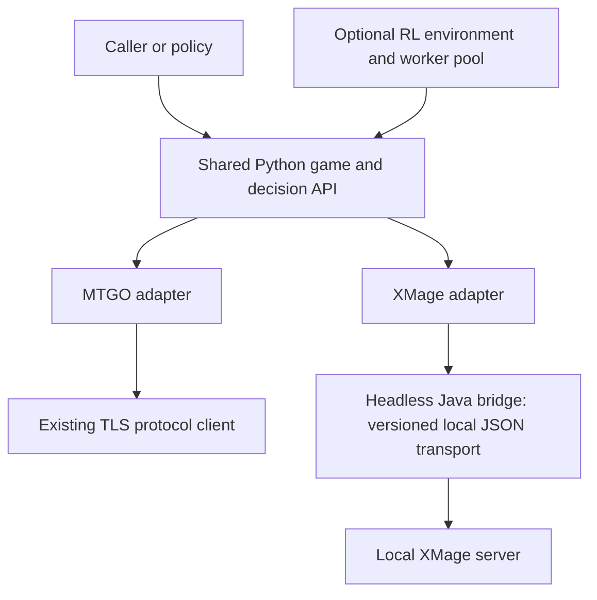

# Dual-backend gameplay and XMage training plan

Status: initial implementation and local server validated. See [setup and measured
coverage](xmage.md). Milestones A/B pass; C passes using explicit concession after
100 choices in each of two games. Generic callback fixtures and the RL runner /
framework wrappers are implemented; advanced live scenarios, exact replay,
training extensions, worker pools and profiling remain future work. Common
MTGO choices retain bundled parameters where the native API requires them;
identical decision trees across engines are not implemented.
Research date: 2026-10-14. Preserve the existing MTGO API and its regression suite.
No CI, live MTGO connections, bot policy, or training algorithm is added by this plan.

## Objective and architecture

Use one Python interaction library to observe and play games on either MTGO or
XMage. Run repeated local XMage episodes for reinforcement learning, with policies
consuming the same normalized decision interface that can later drive MTGO.

A headless bridge is the recommended initial transport, subject to a connection
spike. XMage's SessionImpl uses JBoss Remoting/bisocket, Java objects, and callbacks.
Reuse the relevant native networking code and DTOs rather than implementing Java
serialization in Python. Verify operation with java.awt.headless=true; native
SessionImpl has Swing dependencies, so it cannot simply be assumed GUI-independent.

Evaluate XMage Nexus's existing Mage.Proxy before building a new bridge. Audit
its dependency on its XMage fork, callback coverage, action routing, headless
operation, and license/provenance. Reuse it if suitable; otherwise build a small
bridge against a pinned upstream release. Do not inherit a web UI dependency.
The first version should support an otherwise unmodified XMage server.

## 1. Source and transport discovery

Pin an XMage source commit/release, Java runtime, card database, bridge protocol,
and build instructions together. Audit, using source and executable fixtures:

- Connection, version negotiation, session registration, callbacks, ping, cleanup.
- Game/table creation, seats, deck submission, starting and joining a game.
- Callback sequence numbers and which events may be ignored as stale. A game
  update and an outstanding choice are different kinds of event; never discard
  a required choice merely because a later display update arrived.
- UUID/string/boolean/integer/mana responses and PlayerAction commands.
- Transport write retry behavior and ambiguous outcomes. Disable automatic action
  retries; never replay a game choice after an uncertain write.
- Multi-session/multi-game isolation and version rejection.

Deliverable: a headless Python -> Java -> local-server session that receives a
real game decision and submits a verified response, plus a raw trace fixture.

## 2. Introduce a backend-neutral core without breaking MTGO

Add core protocols for Backend, Session, GameHandle, Observation, Decision,
Response, GameResult, DeckSpec, and Capabilities. Initially wrap the existing
MTGO classes rather than moving/replacing all wire code. Existing imports and
methods remain supported; the new backend-neutral entry point is opt-in.

Separate concepts currently mixed into MTGO models:

| Current assumption | Shared representation |
| --- | --- |
| Integer MTGO game/card/action IDs | Opaque backend-qualified handles; UUIDs stay UUIDs inside XMage adapter |
| Numeric MTGO zone/property IDs | Zone enum and typed state, plus backend-native metadata |
| MTGO timestamp as response identity | Session, episode, game, actor, decision generation, revision |
| Card action bundles targets/modes | Decision tree that also supports sequential callback choices |
| DeckItem catalog/permission fields | Logical card identity, quantity, main/sideboard; backend resolver |
| Inventory, gifts, yield keys | Explicit optional/backend-specific capabilities |

Each immutable decision offers primitive choices and constraints, not a giant
flat list of every possible spell/target/mode/mana combination. Target selection
can be incremental; candidate sets and masks update after each partial choice.
Adapters keep the native response references and bind them to the current
session/decision. Reject cross-game, cross-backend, stale, or duplicate responses.

A structured selection may compile into one MTGO packet or several XMage
responses. Never send future responses before their actual XMage prompts exist.
Local MTGO batches are a capability, not a universal backend assumption.

## 3. Implement the XMage bridge and adapter

Use a versioned JSON message contract over a local socket/WebSocket. Keep stdout
framing and logs separate if a subprocess transport is chosen. Envelopes include
request ID, session, table/game/player IDs, callback sequence, schema version,
and typed event/response data. Keep native objects in Java; serialize deliberate
DTOs rather than reflecting arbitrary Java object graphs.

Implement:

- Local connection, session management, readiness and version checks.
- Create/join/start private tables; two externally controlled seats for self-play.
- Deck resolution and submission; sideboarding and next-game transitions.
- Game views, priority, active/prompted player, stack, zones, counters, results.
- Choice callbacks: ask, select, target, ability, pile, choice list, mana, X mana,
  bounded amount, multiple amounts, and relevant user-request dialogs.
- UUID/string/boolean/integer/mana and PlayerAction response routing.
- Undo/concede and supported yield controls as capabilities, with no invented
  one-to-one equivalence to MTGO controls.
- Timeouts, cancellation, disconnects, malformed events, bounded queues, cleanup.

Actor-visible state is the default. Never union both self-play seats' hands into
one observation. Preserve unknown/hidden cards as unknown objects/counts. Keep
any future privileged training state in a separately opted-in channel that a
policy cannot accidentally receive.

## 4. Map interaction coverage across both backends

Extend interaction-coverage.md with MTGO/XMage columns and concrete fixture IDs.
Map the 135 existing patterns to native callbacks and commands; a mapping is not
proof of complete real-card acceptance.

Prioritize representative local scenarios for:

1. Mulligans, bottoming cards, land plays, casting, priority and mana payment.
2. Optional/multiple/player/stack targets, sequential choices and divided effects.
3. Modes, repeated/weighted modes, casting variants and alternative/additional costs.
4. X, hybrid/Phyrexian choices, restricted/snow mana, sacrifice/discard/exile costs.
5. Searches, scry/surveil/order, piles, names/types, trigger and replacement choices.
6. Attacking, destination choices, blocking, damage distribution and ordering.
7. Split/adventure/modal faces, transformations, Rooms, face-down cards and copies.
8. Counters/player counters, commanders/dungeons, sideboards and results.

Use real server scenarios with deterministic scripted responses for integration
coverage; synthetic fixtures cover framing, errors, freshness and callback races.
Do not infer gameplay choices by parsing English prompt labels when structured
options exist. Surface missing structured information as an explicit gap.

## 5. Add an optional RL environment layer

Keep this outside the core interaction package's mandatory dependencies.

- First implement a backend-neutral decision-step runner. One step answers one
  primitive pending decision, not necessarily one turn or one complete spell.
- reset creates a fresh episode; step waits until the next actionable decision
  or terminal result, ignoring UI-only updates. Enforce the actual prompted actor.
- PettingZoo AEC wrapper for two-seat self-play; Gymnasium wrapper for one learner
  with an explicitly supplied opponent controller.
- Dynamic candidate handles plus masks; schema-versioned encoders map them into
  fixed model spaces. Any size bound must fail explicitly or truncate the episode,
  never silently drop legal actions or objects.
- Reward is configurable and separate from transport. Default terminal win/loss/
  draw; infrastructure failures and decision limits are truncations, not losses.
- Record policy-visible observation, decision, response, result, engine/card data
  versions, deck hashes, seed request, actual seed support and configuration.
- The caller owns the policy. A scripted/random smoke controller is test code.

XMage and MTGO need not expose the same number/order of prompts. Policies target
the common decision semantics; backend-specific mechanics remain discoverable.
Identical observable state/action traces across engines are not an acceptance
requirement, since implementations and supported card sets can differ.

## 6. Training controls and repeatability

Start with a stock server: reset by ending/removing a table and creating a fresh
one. Benchmark before introducing server-side optimizations.

Seeding, fixed opening hands, scenario injection, fast clocks, state inspection,
and exact replay are not assumed stock network features. XMage RandomUtil has a
static RNG with setSeed, so reseeding one process can affect several games. Audit
other RNGs, UUID generation, AI randomness and iteration order before promising
reproducibility. Begin with isolated server processes per seeded worker.

If measurements justify it, add an optional local training extension with
explicit seed/reset/scenario hooks. Keep it separate from the normal XMage
adapter and report its capabilities. Normal observations still respect player
visibility. Do not implement an in-memory rules-engine fork as the initial path.

Measure decisions/second, games/hour, latency distribution, CPU/RAM per worker,
callback queue growth and process leaks. Scale by isolated workers first, then
increase games per server only after isolation/seed tests pass. No throughput
number is promised before profiling.

## 7. Milestones and acceptance gates

| Milestone | Gate |
| --- | --- |
| A: transport spike | Headless local login, two seats, actual game callback and accepted response |
| B: shared core + MTGO wrapper | Existing 117 MTGO tests pass; common freshness/visibility/capability tests pass |
| C: complete XMage game | Two controlled seats finish a game through decisions and actual results; repeat without leaked tables/sessions |
| D: interaction coverage | Each native callback/response family has a fixture; representative advanced scenarios complete |
| E: RL runner | Self-play actor scheduling, reset, terminal/truncation and trajectory replay tests pass |
| F: training workers | Measured throughput and cleanup; requested determinism demonstrated or explicitly unsupported |

Implement A before a large MTGO refactor. Implement C before RL framework
wrappers or performance work. Preserve backward compatibility throughout; local
XMage integration tests are runnable on demand. Do not add CI.

Proposed repository additions:

- src/patchwork_automaton/core/ — common models, protocols, capabilities.
- src/patchwork_automaton/backends/mtgo/ — wrapper around existing implementation.
- src/patchwork_automaton/backends/xmage/ — session, observation/decision mapping.
- xmage-bridge/ — optional headless Java component, if not reusing an external proxy.
- src/patchwork_automaton/rl/ — optional decision runner and environment adapters.
- tests/contract/, tests/xmage/, examples/xmage_selfplay.py.
- docs/xmage-protocol.md and an expanded two-backend interaction checklist.

## Research sources

These are moving upstream branches; implementation must pin the inspected versions.

- [XMage SessionImpl: JBoss transport/session and callback handling](https://github.com/magefree/mage/blob/master/Mage.Common/src/main/java/mage/remote/SessionImpl.java)
- [MageServer: typed server command interface](https://github.com/magefree/mage/blob/master/Mage.Common/src/main/java/mage/interfaces/MageServer.java)
- [ClientCallbackMethod: callback families](https://github.com/magefree/mage/blob/master/Mage.Common/src/main/java/mage/interfaces/callback/ClientCallbackMethod.java)
- [CallbackClientImpl: client callback sequencing and UI dispatch](https://github.com/magefree/mage/blob/master/Mage.Client/src/main/java/mage/client/remote/CallbackClientImpl.java)
- [GameSessionPlayer: server response routing and player-specific views](https://github.com/magefree/mage/blob/master/Mage.Server/src/main/java/mage/server/game/GameSessionPlayer.java)
- [GameView: visible state, playable objects and private/public zones](https://github.com/magefree/mage/blob/master/Mage.Common/src/main/java/mage/view/GameView.java)
- [RandomUtil: process-wide RNG and seed setter](https://github.com/magefree/mage/blob/master/Mage/src/main/java/mage/util/RandomUtil.java)
- [XMage Nexus: existing Java/WebSocket proxy candidate](https://github.com/Adamychen/xmage-nexus)
- [PettingZoo AEC: sequential actors and masks](https://pettingzoo.farama.org/api/aec/)
- [Gymnasium environment interface](https://gymnasium.farama.org/api/env/)
